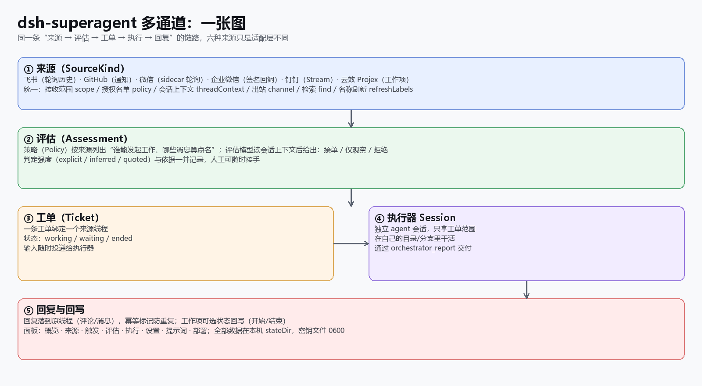
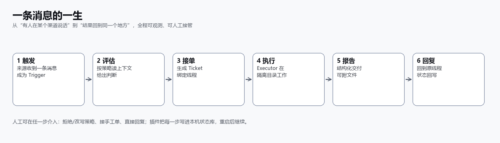
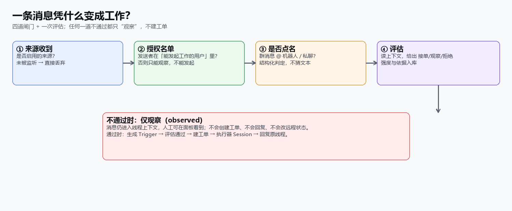
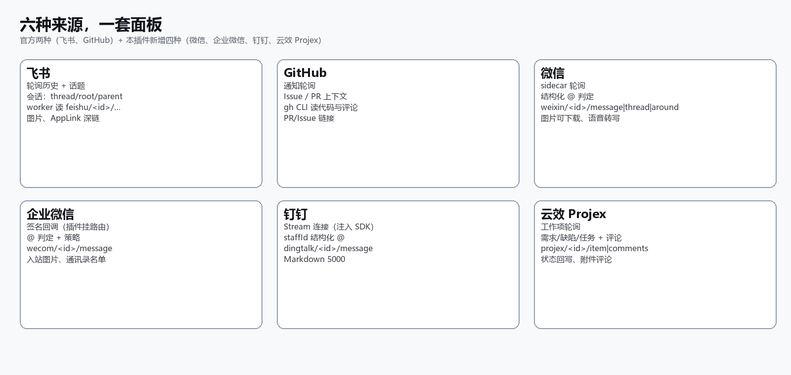
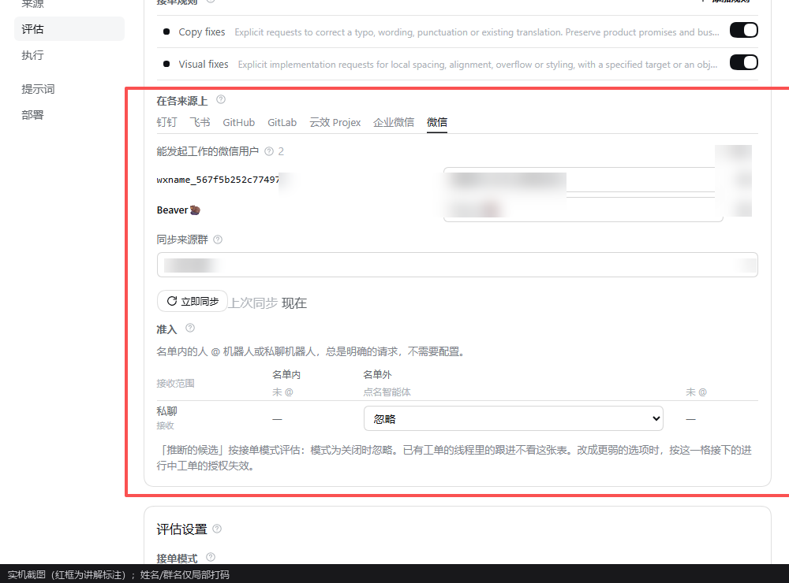
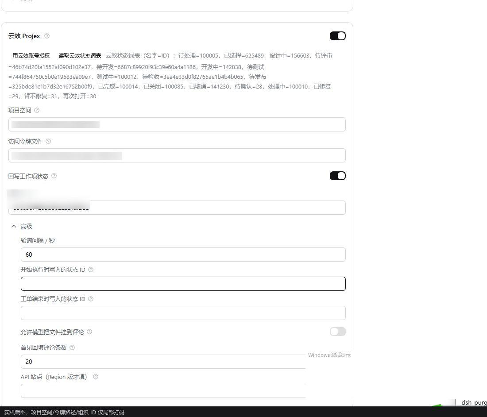
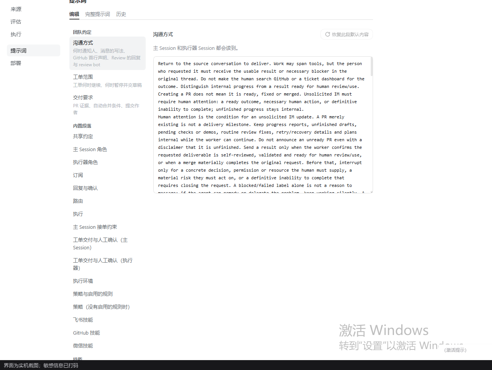
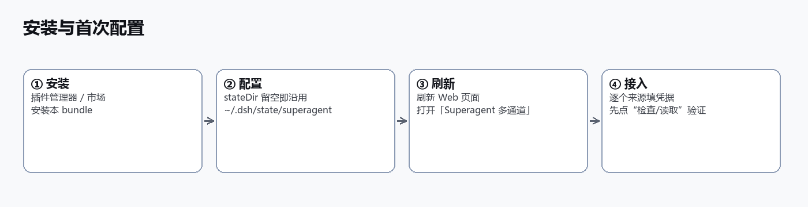
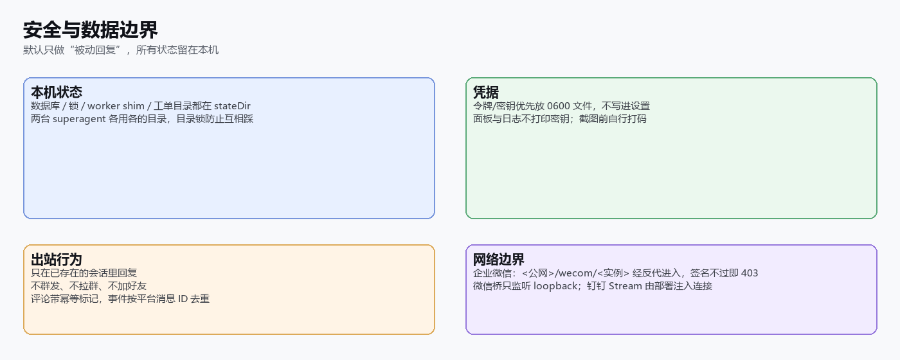

# dsh-superagent multi-channel

> Language: [English](README.md) · [中文](README.zh-CN.md)

**A DSH plugin that wires Feishu, GitHub, WeChat, WeCom, DingTalk and Alibaba Cloud Yunxiao Projex into one
assess → ticket → execute → reply loop.**

Version `2.4.0` · 102 test files / 1,624 passing · MIT · installs beside the official `dsh-superagent`

> An extension of the official open-source superagent: the two official sources (Feishu, GitHub) stay as they are, and
> WeChat, WeCom, DingTalk and Yunxiao Projex are **added** and aligned to the same capability surface (reception scope,
> authorization list, thread context, worker reads, search, label refresh, reply and status write-back). See the
> [capability matrix](docs/extensions/capability-matrix.md).



---

## In one sentence

Someone mentions the bot or messages it on any of six channels → the plugin reads the context under the policy and decides
whether to take it → an **isolated executor session** works in its own directory → the result goes back to the **same
thread**, and a work item's board status can follow along.

## The life of one message



- **Trigger** — all six sources produce one `Trigger` shape (thread, sender, structured `@`, native id).
- **Assess** — the policy names "who may originate work" and "what counts as addressed"; the model reads the thread and
  answers accept / observe / refuse, recording the evidence strength.
- **Ticket** — one ticket binds one source thread; later messages arrive as inputs for the executor.
- **Execute** — the executor session sees only its ticket's scope, works in its own directory/branch, delivers with
  `orchestrator_report`.
- **Reply & write back** — the reply lands in the original thread (comment/message, idempotency-marked); a work item's status
  can move to "in progress" and "done". Everything is in the local `stateDir`; a person can take over at any step.

## Three real scenarios

1. **A Yunxiao defect** — someone @-mentions the bot on a work item ("login 502 intermittently") → the assessment reads the
   item and its comments → a ticket opens → the executor fixes it in an isolated directory → the result is a comment, and
   the board moves from "in progress" to "to test".
2. **A WeChat ops group** — "@bot can you check the expiring certificate?" → the reply goes only into that thread.
3. **A WeCom direct message** — "change this copy" → the reply returns to the same conversation, split into ordered parts,
   with a file delivered as a comment/link when needed.

## What decides it becomes work?



Four gates (enabled source → allowed list → structured mention → assessment). Failing any one only *observes* the message:
no ticket, no reply, no remote change.

## Feature checklist

| Stage | What exists |
| --- | --- |
| Receive | six sources normalised to one Trigger; groups/DMs; structured `@`; optional images; dedupe by platform id |
| Authorize | per-source "who may originate work" + admission table (listed/unlisted × @/un-@/DM) |
| Assess | rule switches, mode (off/observe/auto), deadline, model and effort; every decision records strength and evidence |
| Ticket | one ticket per thread; inputs delivered any time; interruptible, supplementable, human-takeover |
| Execute | isolated executor session and directory/branch; structured report; files returned |
| Reply | back to the original thread; idempotent marker; optional work-item status write-back; visible retries |
| Read originals | per-source worker resources, read-only |
| Panel | overview/sources/triggers/assessment/execution/settings/prompts/deployment; prompts and six skills overridable |
| Security | local state, 0600 secrets, reply-only, platform limits stated |

## Six sources, one panel



| Source | Reception | Highlights |
| --- | --- | --- |
| **Feishu** (official) | history polling | topic/reply chains, AppLink deep links, images, worker reads `feishu/<id>/…` |
| **GitHub** (official) | notification polling | issue/PR context, `gh` for code, PR/issue links |
| **WeChat** (added) | sidecar polling | structured `@`, voice transcripts, downloadable images, worker reads `weixin/<id>/message·thread·around`, post-reattach catch-up |
| **WeCom** (added) | signed callback (plugin mounts `/wecom/<instance>`) | `@` judgement, inbound images, contact-list names, worker reads `wecom/<id>/message` |
| **DingTalk** (added) | Stream (deployment injects the SDK connection) | staffId `@`, Markdown 5000, worker reads `dingtalk/<id>/message` |
| **Yunxiao Projex** (added) | work-item polling | requirement/bug/task + comments, status write-back, attachment comments, worker reads `projex/<id>/item·comments` |

## Panel tour

The plugin has its own sidebar entry, "Superagent multi-channel", beside the official one. **The screenshots below are real
captures; project IDs, token paths, organisation IDs, names and chat names are masked.**







## Install and first run



1. **Install** the bundle from the plugin manager (directory, npm package or tarball), or from the market once listed.
2. **Configure**: leave `stateDir` empty to adopt an existing `~/.dsh/state/superagent` (no migration); two superagent
   installs each need their own directory.
3. **Refresh** the web page and open "Superagent multi-channel".
4. **Connect a source**: fill its card and use the card's Check / Read action before enabling it.

More in [deployment](docs/006-deployment.md); per-channel steps in [EXTENSIONS.md](EXTENSIONS.md).

## Security and boundaries



- **Reply only**: no broadcasts, no group invites, no friend requests.
- **Secrets stay local**: tokens/keys live in 0600 files rather than settings; screenshots and logs never print them.
- **Idempotency and dedupe**: comments carry a marker, callbacks dedupe by platform message id; WeCom and DingTalk have no
  server-side idempotency key and say so in `facts`.
- **No faked platform behaviour**: WeChat/WeCom/DingTalk have no message deep link, the two push backends have no history to
  page, and DingTalk's stream needs an injected SDK connection. See the [capability matrix](docs/extensions/capability-matrix.md).

## FAQ

**Does it auto-reply to everyone?** No. Only threads the assessment accepted get a reply; a message from an unlisted person is
observed at most.
**Where does data go?** Everything stays in the local `stateDir`; data reaches a platform only when the plugin calls that
platform's API to read or reply.
**Can it run beside the official superagent?** Install both, but enable one at a time (a Host accepts one Source kind per id);
each keeps its own `stateDir`.
**Does upgrading lose data?** No. `stateDir` is unchanged and, since 2.3.0, the agent presets keep the shared ids so old
sessions resume.
**A source receives nothing?** See the troubleshooting table in [docs/008-cookbook.md](docs/008-cookbook.md): WeCom callback
URL and token, DingTalk's injected stream connection, the WeChat bridge `/health`.

## Documentation map

| Document | What it covers | Length / Audience |
| --- | --- | --- |
| [docs/README.en-US.md](docs/README.en-US.md) | Reading order and the full map (中文：[docs/README.md](docs/README.md)) | 46 lines · start here |
| [docs/000-philosophy.md](docs/000-philosophy.md) | Why assess → ticket → execute | 35 lines · everyone, ~10 min |
| [docs/001-domain.md](docs/001-domain.md) | Trigger / Thread / Ticket / Assignment | 114 lines · developers, integrators |
| [docs/002-authorization.md](docs/002-authorization.md) | Policy, allowed lists, addressed detection | 157 lines · admins, security review |
| [docs/003-execution.md](docs/003-execution.md) | Executor sessions, directories, delivery | 205 lines · developers, operators |
| [docs/004-prompts.md](docs/004-prompts.md) | Prompts and skills | 98 lines · prompt maintainers |
| [docs/005-panel.en-US.md](docs/005-panel.en-US.md) | The panel page by page (with screenshots) | 60 lines · everyday users |
| [docs/006-deployment.md](docs/006-deployment.md) | Deployment, settings, upgrades, coexistence | 298 lines · deployers, operators |
| [docs/007-architecture.md](docs/007-architecture.md) | Architecture, module and test tables | 713 lines · maintainers, contributors (as an index) |
| [docs/008-cookbook.en-US.md](docs/008-cookbook.en-US.md) | Recipes and troubleshooting | 51 lines · on-call, troubleshooting |
| [docs/extensions/capability-matrix.md](docs/extensions/capability-matrix.md) | Six-source comparison and platform limits | 42 lines · selection, review |
| [docs/extensions/](docs/extensions/) | ADR-005 … ADR-012 (each in English and Chinese) | 40–356 lines each · decision history |
| [docs/gallery.en.html](docs/gallery.en.html) | Illustrated preview (中文：[docs/gallery.html](docs/gallery.html)) | image pages · demo, review |

## Develop and test

```bash
pnpm typecheck   # tsc --noEmit
pnpm test        # vitest run --maxWorkers=2
pnpm build       # tsdown, eight entries
```

Latest full regression (2026-11-14, 2.4.0): `tsc` 0; **102 files passed / 5 skipped, 1,624 passed / 41 skipped, 0 failed**;
`tsdown` build complete.

## License

MIT, with the upstream `dsh-superagent` notices kept. WeChat UI automation is a third-party tool without Tencent's
authorization and may break at any time; use it within [ADR-005](docs/extensions/ADR-005-weixin-backend.md)'s boundary (reply
only when mentioned, no broadcasts, no bulk friend requests, one account online at a time).

---

<sub>Screenshots are real captures with sensitive fields (project/organisation IDs, token paths, names, chat names, session
titles) masked; the architecture and lifecycle images are diagrams drawn from the current implementation.</sub>
