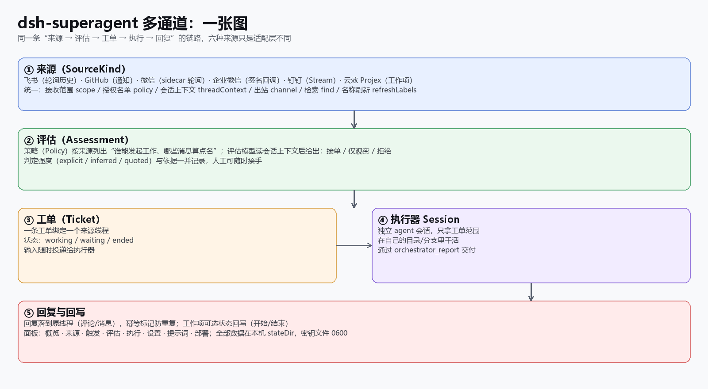
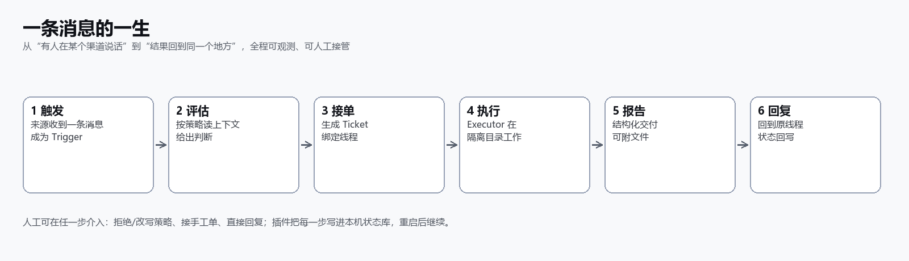
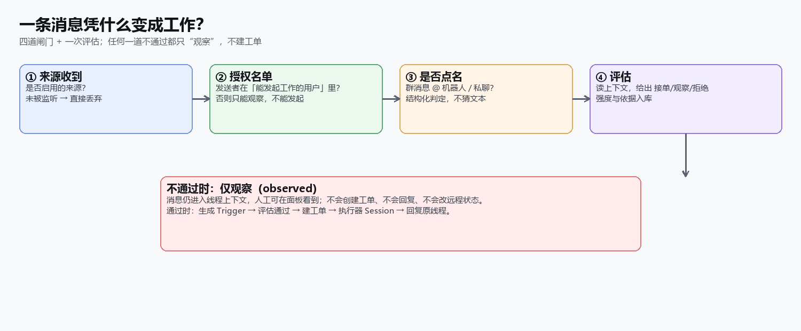
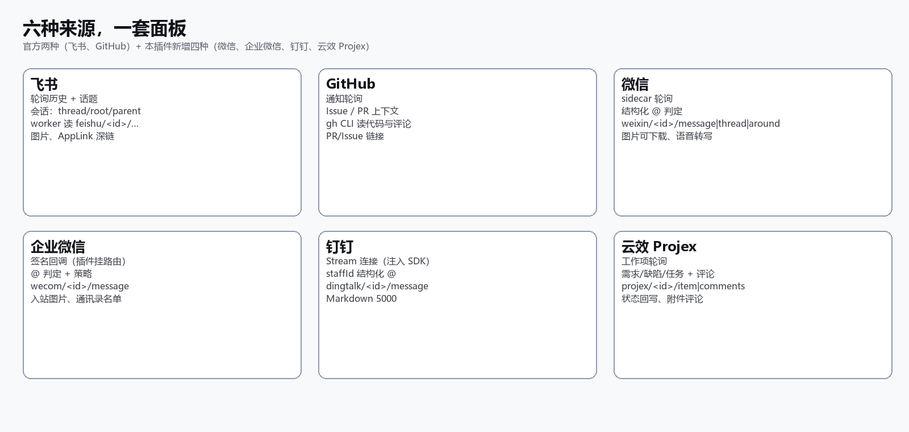
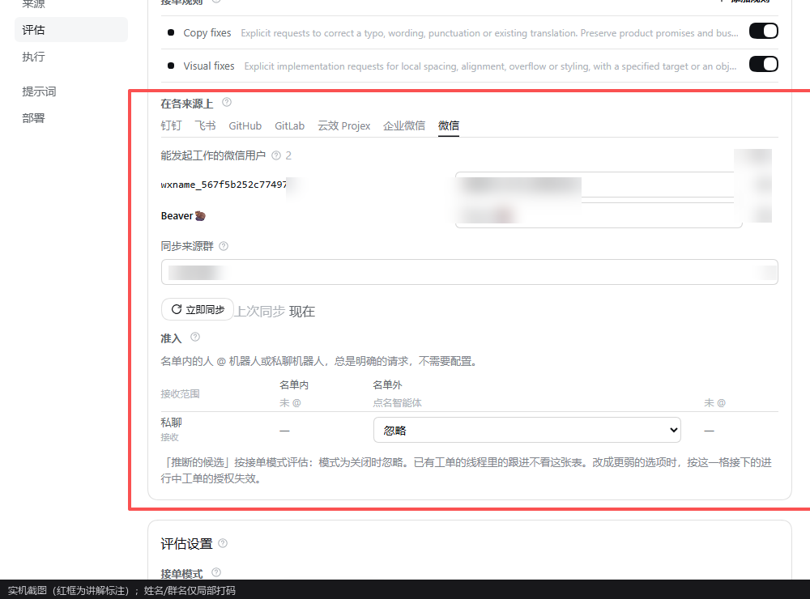
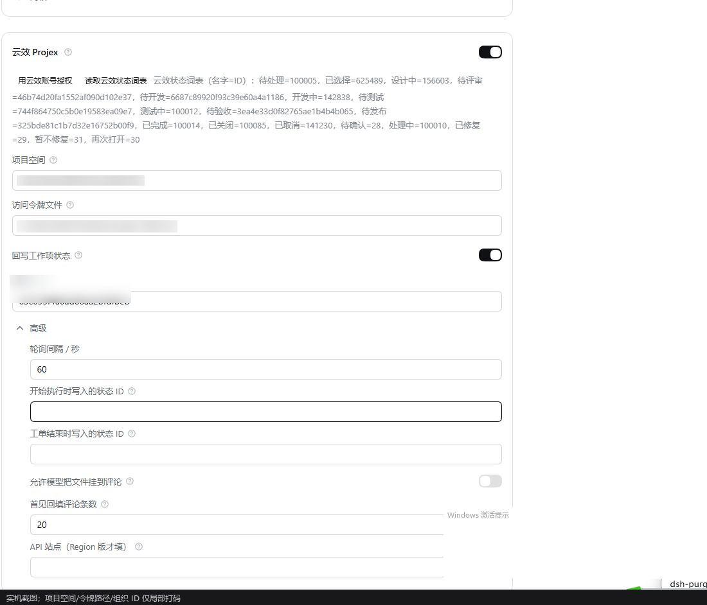
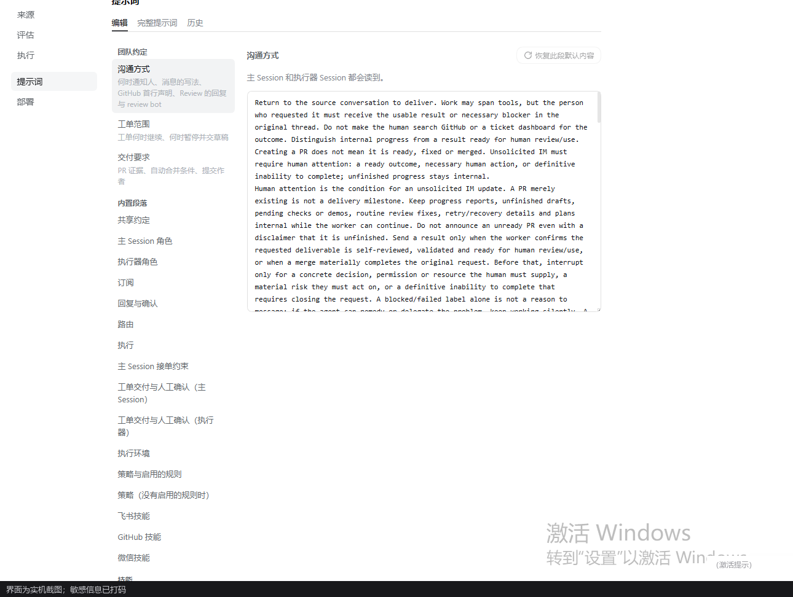
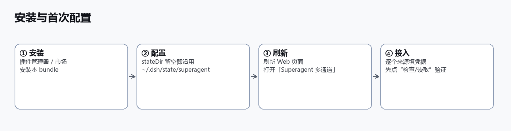
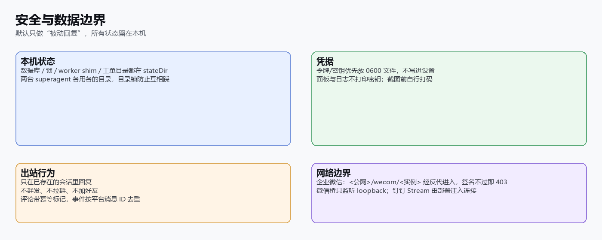

# dsh-superagent 多通道

**把飞书、GitHub、微信、企业微信、钉钉、阿里云云效 Projex 接成同一套「评估 → 工单 → 执行 → 回复」闭环的 DSH 插件。**

版本 `2.4.0` · 测试 102 文件 / 1624 通过 · 许可 MIT · 与官方 `dsh-superagent` 并存安装

> 本仓库是官方开源 superagent 的扩展：官方两种来源（飞书、GitHub）保留原样，**新增**微信个人号、企业微信、钉钉与云效 Projex，并把它们对齐到同一套能力面（接收范围、授权名单、会话上下文、worker 读原文、检索、名称刷新、回复与回写）。逐项对照见 [能力矩阵](docs/extensions/capability-matrix.md)。



---

## 一句话

有人在某个渠道里 @ 机器人或私聊它 → 插件按策略读上下文、评估要不要接 → 接了就开一个**独立执行器会话**在隔离目录里干活 → 结果回到**原来那条线程**，工作项还能顺手把看板状态往前推。

## 一条消息的一生



- **触发**：六个来源都产出同一种 `Trigger`（带线程、发起人、结构化 @、原始 ID）。
- **评估**：策略按来源配置「谁能发起工作」「哪些消息算点名」；评估模型读会话上下文，输出 接单 / 仅观察 / 拒绝，并记录判定强度与依据。
- **工单**：一条工单绑定一个来源线程，后续消息作为输入投递给执行器。
- **执行**：执行器 Session 只拿工单范围，在自己的目录/分支里工作，结构化 `orchestrator_report` 交付。
- **回复与回写**：回复落到原线程（评论/消息，带幂等标记），工作项可选状态回写（开始/结束）。
- 全程写入本机 `stateDir`，重启后继续；人工可在任何一步接手。

## 三个真实场景

1. **云效缺陷单**：有人在需求/缺陷里 @ 机器人「登录偶发 502」→ 评估读工作项与评论 → 建工单 → 执行器在隔离目录修 →
   评论里交付，看板状态自动从「处理中」走到「待测试」。
2. **微信群运维**：群里 @ 机器人「帮忙看下证书快到期」→ 只在这一条线程里回应，不给无关的人发消息。
3. **企业微信私聊**：产品私聊「这个文案改一下」→ 回到同一会话，改完的长文分段发送，需要时把文件作为评论/链接交付。

## 凭什么变成工作？



四道闸门（启用的来源 → 授权名单 → 结构化点名 → 评估）任何一道不通过，消息只进入线程上下文供人查看，**不会建工单、不会回复、不会改远程状态**。

## 功能清单

| 环节 | 已经有 |
| --- | --- |
| 接收 | 六种来源统一成 Trigger；群/私聊；结构化 @；可选图片；按平台消息 ID 去重 |
| 授权 | 每个来源独立的「能发起工作的人」名单 + 准入表（名单内外 × @/未 @/私聊）；人工可随时收紧 |
| 评估 | 规则开关、接单模式（关闭/仅观察/自动）、单次时限、模型与推理强度；每次记录判定、强度、依据 |
| 工单 | 一工单一线程；输入随时投递；可中断、可补充、可人工接手 |
| 执行 | 独立执行器会话与目录/分支；结构化报告；文件可回传 |
| 回复 | 回到原线程；评论幂等标记；工作项可选状态回写；失败重试可见 |
| 读原文 | 飞书/GitHub/微信/企业微信/钉钉/云效 各自的 worker 资源（只读） |
| 面板 | 概览/来源/触发/评估/执行/设置/提示词/部署；提示词与六个来源技能可覆盖 |
| 安全 | 本机状态、0600 凭据、只被动回复、平台限制公开写明 |

## 六种来源，一套面板



| 来源 | 接收方式 | 关键能力 |
| --- | --- | --- |
| **飞书**（官方） | 轮询历史 | 话题/回复链、AppLink 深链、图片、worker 读 `feishu/<id>/…` |
| **GitHub**（官方） | 通知轮询 | Issue/PR 上下文、`gh` 读代码、PR/Issue 链接 |
| **微信**（新增） | sidecar 轮询 | 结构化 @、语音转写、图片可下载、worker 读 `weixin/<id>/message·thread·around`、重挂补读 |
| **企业微信**（新增） | 签名回调（插件自挂 `/wecom/<实例>`） | @ 判定、入站图片、通讯录名单、worker 读 `wecom/<id>/message` |
| **钉钉**（新增） | Stream（部署注入 SDK 连接） | staffId 结构化 @、Markdown 5000、worker 读 `dingtalk/<id>/message` |
| **云效 Projex**（新增） | 工作项轮询 | 需求/缺陷/任务+评论、状态回写、附件评论、worker 读 `projex/<id>/item·comments` |

## 面板导览

插件在侧边栏有独立入口「Superagent 多通道」，与官方入口互不覆盖。**以下截图为实机截图，项目 ID、令牌路径、组织 ID、姓名、群名等敏感信息均已打码。**

### 评估与策略

按来源列出「谁能发起工作」，并把准入表按行展示：名单内/名单外 × 群里 @/未 @/私聊，每一格都能改。



### 来源卡片（以云效 Projex 为例）

授权、读取状态词表、项目空间、令牌文件、状态回写开关、轮询间隔，两个回写状态是**下拉选择**（显示看板名字，存状态 ID）。



### 提示词

主 Session 与执行器 Session 的每段文本都可查看与覆盖；六个来源技能（飞书、GitHub、微信、云效 Projex、企业微信、钉钉）都在这里逐段呈现。



## 安装与首次配置



1. **安装**：插件管理器按目录 / npm 包 / tarball 安装本 bundle（或从插件市场收录后一键安装）。
2. **配置**：`stateDir` 留空即沿用已存在的 `~/.dsh/state/superagent`（旧版升级无需迁移）；两台 superagent 并存时各用各的目录。
3. **刷新**：刷新 Web 页面，打开侧边栏「Superagent 多通道」。
4. **接入来源**：逐个卡片填凭据，先点卡片上的「检查 / 读取」验证，再启用。

> 完整字段与排障见 [部署](docs/006-deployment.md)；每个来源的接入步骤见 [扩展说明](EXTENSIONS.zh-CN.md)。

## 安全与边界



- **只被动回复**：不群发、不拉群、不加好友；只在收到的会话里回应。
- **凭据在本机**：令牌/密钥优先放 0600 文件，不写进设置；截图与日志不打印密钥。
- **幂等与去重**：评论带幂等标记；回调/事件按平台消息 ID 去重；钉钉、企业微信的出站无服务端幂等键，已在 `facts` 明说。
- **平台限制不伪装**：微信/企业微信/钉钉没有消息深链；企业微信、钉钉是推送型后端，没有历史可翻；钉钉 Stream 需要部署注入 SDK 连接。详见 [能力矩阵](docs/extensions/capability-matrix.md)。

## 常见问题

**会不会给所有人自动回复？** 不会。只有被评估接单的线程才会收到回复；名单外的人即使 @ 机器人也只被“观察”。
**数据会传到哪？** 默认全部留在本机 `stateDir`；只有程序调用各平台 API（读取/回复）时，数据才到对应平台。
**能和官方 superagent 同时跑吗？** 可以同时安装，但同一时刻只能启用一个（同一种 Source kind 只能注册一次）；各自用自己的 `stateDir`。
**升级会丢数据吗？** 不会。`stateDir` 不变；2.3.0 起 agent preset 沿用共享 id，旧会话可直接恢复。
**某个来源收不到消息？** 看 [docs/008-cookbook.md](docs/008-cookbook.md) 的排障表：企业微信查回调 URL 与 Token、钉钉查是否注入 Stream 连接、微信查桥 `/health`。

## 文档地图

| 文档 | 内容 |
| --- | --- |
| [docs/README.md](docs/README.md) | 文档总览与阅读顺序 |
| [docs/000-philosophy.md](docs/000-philosophy.md) | 设计哲学：为什么是「评估→工单→执行」 |
| [docs/001-domain.md](docs/001-domain.md) | 领域模型：Trigger / Thread / Ticket / Assignment |
| [docs/002-authorization.md](docs/002-authorization.md) | 授权与准入：策略、名单、点名判定 |
| [docs/003-execution.md](docs/003-execution.md) | 执行：执行器会话、目录隔离、交付 |
| [docs/004-prompts.md](docs/004-prompts.md) | 提示词与技能 |
| [docs/005-panel.md](docs/005-panel.md) | 面板逐页说明（含截图） |
| [docs/006-deployment.md](docs/006-deployment.md) | 部署、配置项、升级与并存 |
| [docs/007-architecture.md](docs/007-architecture.md) | 架构与模块/测试清单 |
| [docs/008-cookbook.md](docs/008-cookbook.md) | 常见做法与排障 |
| [EXTENSIONS.zh-CN.md](EXTENSIONS.zh-CN.md) | 逐通道功能点（中文） |
| [docs/extensions/capability-matrix.md](docs/extensions/capability-matrix.md) | 六来源能力对照与平台限制 |
| [docs/extensions/](docs/extensions/) | ADR-005 … ADR-012 |

## 开发与测试

```bash
pnpm typecheck          # tsc --noEmit
pnpm test               # vitest run --maxWorkers=2
pnpm build              # tsdown，8 个入口
```

最近一次全量回归（2026-11-14，2.4.0）：

```
tsc --noEmit   → 0
vitest         → 102 files passed / 5 skipped (107)
                 1624 passed / 41 skipped (1665)   0 failed
tsdown         → Build complete
```

## 许可

MIT。上游 `dsh-superagent` 的版权声明保留；微信的 UI 自动化是第三方工具，未获腾讯授权，可能随时被客户端或平台限制，必须在 [ADR-005](docs/extensions/ADR-005-weixin-backend.md) 记录的行为边界内使用（只在被 @ 时回复、不群发、不批量加友、同一时刻只有一个账号在线）。

---

<sub>截图说明：面板截图为真实运行截图，敏感信息（项目/组织 ID、令牌路径、姓名、群名、会话标题）已打码；架构图与流程图是按当前实现绘制的示意图。</sub>
