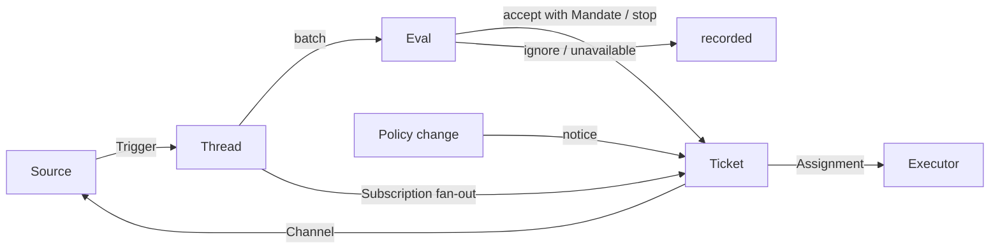

# 001 领域模型

> 语言：[中文](001-domain.zh-CN.md) · [English](001-domain.md)

本文命名 dsh-superagent 的概念，以及每个概念遵守的规则。代码、智能体调用的工具、面板以及其他文档都使用这些术语，不使用别的术语。遵循 [000 理念](000-philosophy.md)，模型只包含工作所需的概念，一个业务需求会成为其中某个概念的属性。

## 流程

工作从触发流向评估，再流向执行。来源产生触发。触发作为上下文扇出到订阅了它所属线程的工单。以这种方式到达某个工单的人的消息留在该工单上；其他每个触发都进入评估，由评估决定是否请求新工作。评估接受时，会创建一个带授权的工单。派工把工单交给执行器，结果通过渠道回到来源。

## 概念

来源、线程、评估、授权和订阅构成核心领域；其余概念为它们提供支撑。

| 概念 | 定义 | 遵守的规则 | 存在的原因 |
| --- | --- | --- | --- |
| 来源 | 一个事件流。来源种类是可复用的实现；来源实例是某个种类的一份配置：是否运行、监听什么 | 保存自己的读取位置和自己的机器人身份。定义什么算一个事件，包括只在时间上成立的条件。在进入领域之前丢弃机器人自己的消息和超出监听范围的触发。把每个触发翻译成它所属的线程，以及用于回复的渠道地址 | 重启之后不能重放事件 |
| 触发 | 一个不可变事件，带有来源自己的元数据，例如它的发起者 | 属于一个或多个线程。同一个触发被接受两次只创建一个工单 | 审计与幂等的单位 |
| 线程 | 按时间顺序排列的触发；由来源定义哪些触发构成同一个线程 | 同一时刻最多有一个评估在其上运行。它可以有多个工单。它持有自己的订阅、正在运行的评估以及决定历史 | 为评估提供一致的视图和上下文 |
| 关联 | 一个触发所属的多个线程之间的关系 | 只增加上下文；从不路由 | 让评估能够追踪相关的证据 |
| 渠道 | 线程的写侧；由来源定义它的地址 | 一个线程可以有多个渠道；一个工单持有一组渠道 | 确认、回复、拉取请求和已处理的评审都是写操作 |
| 策略 | 带版本的评估规则，以及每个来源的那一部分：谁可以通过该来源、以该来源自己的身份发起工作，名单如何同步，以及哪些机器人可以产生候选 | 策略版本覆盖规则、接单模式和来源各部分。影响在途工单的变更（例如改动它当初被接受时依据的规则）会投递给它的派工；这种变更不会撤销授权。不同来源上的身份永不互相映射 | 规则改变时，正在运行的评估必须被丢弃 |
| 评估 | 对一批触发的判定，分两层：准入与研判 | 输入：触发批次、线程快照、线程上的所有工单（包括已结束的），以及当前策略。输出：一个决定。不持有状态 | 决定新工作是开始、继续还是停止 |
| 授权 | 一次接受所授予的东西：策略版本、范围、强度、命中的规则、发起者在该来源上的身份，以及来源接收该触发的方式 | 不可变；更大的范围意味着新工单。工单的结束不会结束授权：只有人的停止会撤回它，而不再成立它的策略会撤销它。已结束的工单恢复之前，会针对当前策略重新校验 | 说明这项工作为什么可以做，以及可以做到多远 |
| 工单 | 一个被授权的工作单元 | 只有评估能创建它。引用它的授权；持有它的渠道和输入。状态从开启 → 结束，当有人在它的某个线程上发言使其恢复时回到开启，除非人已停止它。它定义自己的状态，而不跟随执行器的状态 | 拥有执行过程及其报告 |
| 派工 | 一个工单与一个执行器实例的绑定 | 一个工单在一段时间内可以有多个派工。状态独立于工单，从待启动 → 执行中 → 已结束。只有它的最终报告可以结束执行器一侧的工单 | 执行器在领域之外，但谁在执行必须在领域之内 |
| 订阅 | 工单与线程之间的多对多关系，由线程持有 | 匹配的触发会扇出到每个在役的已订阅工单，不检查是谁发的；以这种方式到达工单的人的消息不经过评估。执行器为获取上下文而跟随的线程以同样方式到达其工单，但不为它带来任何权限，也不会恢复它。已结束的工单保留它的订阅，包括已关闭或已合并的拉取请求的订阅：人的消息会在同一授权下恢复它，无需评估或决定；机器人和 CI 的消息不会到达它，因为它的执行器在恢复时会重新读取它的线程。被人停止的工单不再接收任何东西。主会话只有在消息明确指向某个工单时，才把线程附加到该工单。人可以丢弃线程上的所有订阅；执行器只能丢弃自己工单对某个它认为无关的线程的订阅，例外是它工单起始所在的线程，以及来源让它跟随的线程，例如它拉取请求的线程 | 后续讨论无需再提及智能体就能到达执行器 |

人不是领域概念。触发携带其发起者的标识符，形式由来源给出。白名单是策略中某个来源的那一部分，使用该来源的身份。同一个人在多个来源上拥有账号这件事，是智能体在需要时阅读的提示词文本。

执行器及其会话和目录位于领域之外，通过派工连接进来。

聚合：来源持有它的读取位置。线程持有它的订阅、正在运行的评估（串行运行，并把期间到达的触发合并进下一批）以及它的决定历史。工单持有它的派工、渠道和输入，并通过 id 引用决定。

## 被拒绝的概念

| 被拒绝的 | 原因 |
| --- | --- |
| 把主体或成员关系作为实体，或在来源之间映射身份 | 人是触发的元数据；白名单是策略中来源的一部分；跨来源映射是提示词文本 |
| 由评估自己调度延迟触发 | 需要等待的条件就是一个普通来源，因此评估永不反向依赖来源 |
| 等待中或已撤销的评估状态 | 等待属于来源；超时的评估会重新排队它的触发，或以 `unavailable` 结束 |
| 每个线程最多一个在役工单 | 一个线程可以承载多个独立的工作片段；研判通过工单列表避免重复 |
| 「追加到工单」这种决定 | 追加就是订阅扇出，不需要评估 |
| 对订阅做准入检查 | 订阅覆盖整个线程；授权把授权与上下文分开 |
| 会路由的关联 | 订阅负责路由；关联只增加上下文 |
| 跟随 DSH 会话的工单状态 | 工单可以被移交、恢复，或由多个执行器运行，因此它定义自己的状态 |
| 由执行器声明某人要求它停止 | 只有评估决定结束的强度 |
| 策略变更时取消正在运行的工单 | 被取消的变更会留下半成品工作；改为记录并投递该变更 |
| 执行器会话失败或阻塞时锁死它的所有工具 | 这会拒绝人在会话中的直接操作，以及恢复后的报告；暂停自动输入就够了 |
| 从报告的自由文本推断「在等人」 | 该分类需要结构化事实；执行器通过结构化字段提问 |

## 可复用的部分

上述概念及其规则是可复用的。来源实现、策略内容、执行器以及渠道实现属于某个部署。每个来源在内部保留自己的用词，例如消息、聊天或通知，并把它们翻译成触发。

| 部分 | 本仓库中的实现 |
| --- | --- |
| 来源 | 飞书：实时事件、历史回溯、订阅话题的轮询。GitHub：通知、已订阅的 Issue 与拉取请求、CI 变更、已合并或已关闭的拉取请求，以及在开启时仓库中每个新 Issue、拉取请求和评论，以及默认分支的 CI |
| 策略 | 研判规则，以及每个来源的白名单、它的同步、它的机器人名单和它的准入表 |
| 执行器 | 一个 DSH 执行器会话，以及每个工单一个目录，位于一个执行环境中，该环境的变量由执行器和来源注册 |
| 渠道 | 飞书话题回复、GitHub 评论与评审线程回复 |

## 术语表

本文及后续文档所用术语的参考列表，附其中文名；上面未介绍的术语由后续文档解释。面板一次只显示一种语言；它的 (?) 按钮会用两种语言打开本术语表。智能体在 GitHub 和飞书上发给人的消息使用平实语言，不使用这些术语。

| 术语 | 中文 | 含义 |
| --- | --- | --- |
| Agent | 智能体 | dsh-superagent 运行的自动化团队成员，通过 GitHub 账号、飞书机器人等身份在来源上行动 |
| Main Session | 主 Session | 评估触发、接受并派发工单、以及回复的 DSH 会话；在代码和提示词中为 `orchestrator` |
| Executor Session | 执行器 Session | 执行器为一个工单运行的 DSH 会话；在代码和提示词中为 `worker` |
| Source | 来源 | 一个事件流：由插件提供的一个种类，加上一份实例配置 |
| Trigger | 触发 | 来自来源的一个不可变事件 |
| Thread | 线程 | 按时间顺序排列的触发；评估在其内部一次只运行一个的单位 |
| Correlation | 关联 | 共享同一个触发的多个线程之间的关系；它只增加上下文 |
| Channel | 渠道 | 线程的写侧 |
| Policy | 策略 | 用于接受工作的带版本规则，以及每个来源在其中的那一部分，例如谁可以在那里请求工作 |
| Policy version | 策略版本 | 一种规则、来源各部分与接单模式组合的标识符；每个授权都会记录它 |
| Eval | 评估 | 把一批触发变成一个决定的过程 |
| Gate | 准入 | 评估中确定性的第一层：谁可以发起工作，以及以什么强度 |
| Assessment | 研判 | 评估过程中模型的判断 |
| Decision | 决定 | 评估的结果 |
| Mandate | 授权 | 一次接受所授予的东西：强度、范围以及它所依据的策略版本 |
| Ticket | 工单 | 一个被授权的工作单元 |
| Assignment | 派工 | 一个工单与一个执行器实例的绑定 |
| Subscription | 订阅 | 工单与线程之间的关系 |
| Fan-out | 扇出 | 把已订阅线程的触发作为上下文投递给工单 |
| Executor | 执行器 | 运行派工的端口：每个工单一个执行器会话和一个目录 |
| Execution environment | 执行环境 | 执行器会话与 prepare 命令运行的地方：由执行器和来源注册的变量，每个变量有键、值和描述 |
| Report | 报告 | 派工向其工单报告的状态 |
| Attention | 待人工决定 | 工单上等待人回答的问题 |
| Disposition | 去向 | 一个触发被过滤、被评估或被扇出的记录 |
| Input | 输入 | 投递给工单的上下文：扇出的触发、策略变更、恢复和文本 |
| Scope | 范围 | 授权允许的工作 |
| Strength | 强度 | 授权或评估的依据有多强 |

| 分组 | 取值 |
| --- | --- |
| Decision | accept 接单 · stop 停止 · ignore 忽略 · unavailable 未完成 |
| Strength | explicit 明确 · inferred 推断 |
| Assignment | pending 待启动 · running 执行中 · ended 已结束 |
| Report | progress 进展 · waiting 等待 · ready 就绪 · blocked 受阻 · failed 失败 · dropped 无需处理 |
