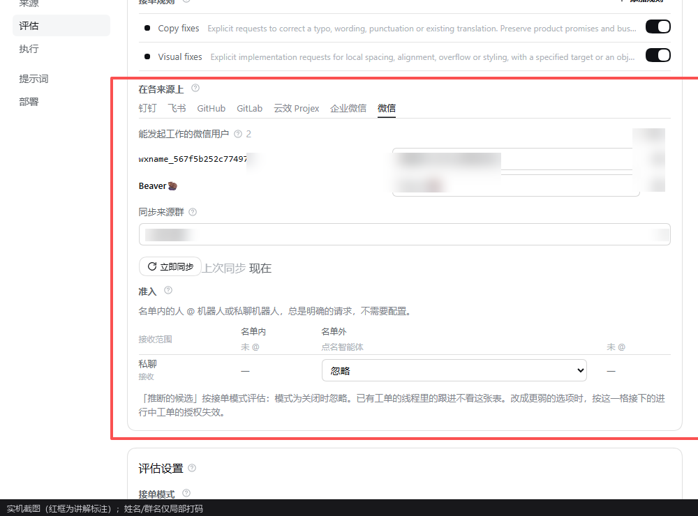
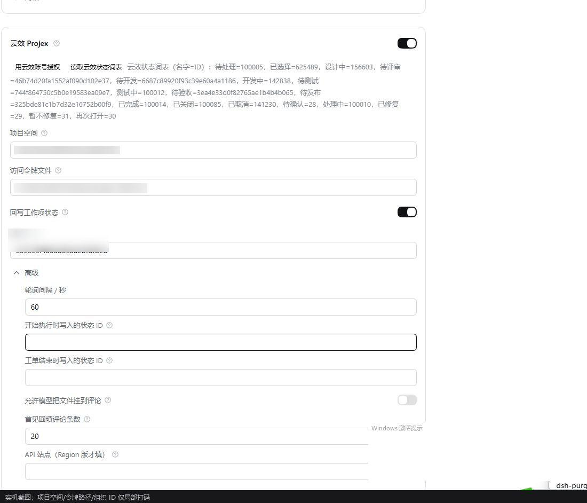
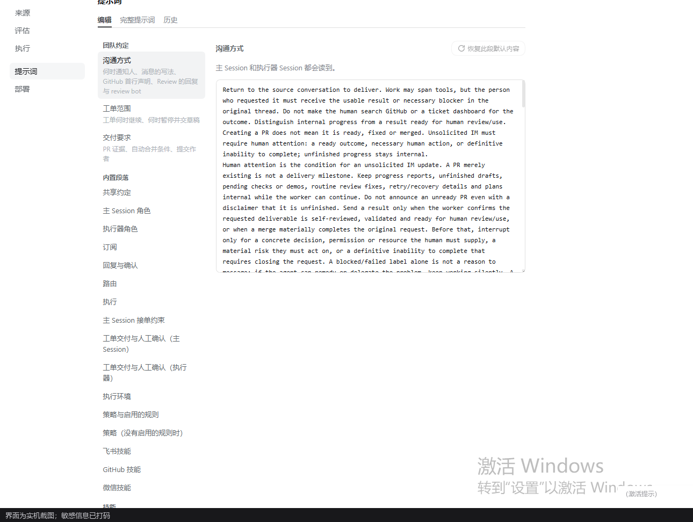

# The panel, page by page

> Language: [English](005-panel.en-US.md) · [中文](005-panel.md)

The panel lives in the sidebar under "Superagent 多通道" (Superagent multi-channel), and does not replace the official entry points. The left column is fixed: **来源 / 评估 / 执行 / 提示词 / 部署** (Sources / Assessment / Execution / Prompts / Deployment), with **概览** (Overview) at the top.
All screenshots below are from a real deployment, with sensitive information redacted.

## Overview

- Statistics at the top: Tickets awaiting action, assessments in progress, messages blocked by Policy, failed replies and so on; clicking a number jumps to the matching list.
- Cards point out **what to do next** (for example "a Source is not configured", "a reply keeps failing"), and offer a clickable fix action.
- "打开主 Session" (Open the main Session) goes straight into the orchestrator's conversation, so a person can take over.

## Sources

Each Source is one card:

- A switch decides whether it is enabled; an unconfigured card says "来源未启用 / 等待配置" (Source not enabled / awaiting configuration).
- A card carries that Source's **actions**: checks for Feishu and GitHub, "启动桥 / 停止桥 / 检查" (Start bridge / Stop bridge / Check) for WeChat, "用云效账号授权 / 读取云效状态词表" (Authorize with a Yunxiao account / Read the Yunxiao status vocabulary) for Yunxiao, checks for WeCom and so on.
- Fields are grouped as needed, credentials preferably live in a 0600 file; old fields are marked as migrated to the new location (they are not silently dropped).

Taking Yunxiao Projex as an example: authorization, status vocabulary, project space, token file, status write-back and the two **status dropdowns** (they show the board's names and store status IDs), polling interval, the attachment-comment switch, how many items to backfill on first sight, and the API site.

## Triggers

- Lists every Trigger received in reverse time order: which Source/Thread it came from, who sent it, the strength of the judgement, which Ticket it went to, or why it was ignored.
- Clicking through to a Thread shows the context and the original message; "重新评估" (Re-evaluate) hands the Trigger back to assessment (it does not change authorization).

## Assessment

- The upper half is **Policy**: rule switches (such as Copy fixes / Visual fixes, customizable), each Source's list of "users who may start work", and the admission table (on/off the list × mentioned in the chat / not mentioned / direct message).
- The lower half is **assessment settings**: accept mode (off / observe only / accept automatically), the time limit for one assessment, the assessment model and its reasoning effort.
- Every assessment records: the Decision, the strength (explicit / inferred / quoted), the basis and the duration; "评估未完成" (Assessment did not finish) shows a reason instead of a blank.

## Execution

- Tickets in progress, their Executor Sessions, and the current stage (working / waiting / ended).
- Each Ticket shows: the task description, the input messages, a summary of the Executor's conversation, and the latest Report; it can be interrupted, asked for more, or replied to directly.
- An Executor receives only the Ticket's scope; file deliveries go back to the original Thread as attachments in the Report.

## Prompts

- Every part of the main Session's and the Executor Session's prompt can be viewed and overridden; changes are saved as versions, with history comparison and restore-to-default.
- Six Source skills each take one part: Feishu, GitHub, WeChat, Yunxiao Projex, WeCom and DingTalk.

## Deployment

- Shows the current `stateDir`, the database version, health-check results, and the state of background tasks (bridges, pollers).
- Upgrade notices and migration records appear here; when two superagents coexist, each shows its own directory and lock.

## Screenshots and privacy

- The panel never prints tokens; before taking a screenshot, still check names, chat names and project IDs, and redact them if needed before publishing.
- The examples in this repository's `docs/images/` are already redacted; keep the same redaction standard when replacing them.
