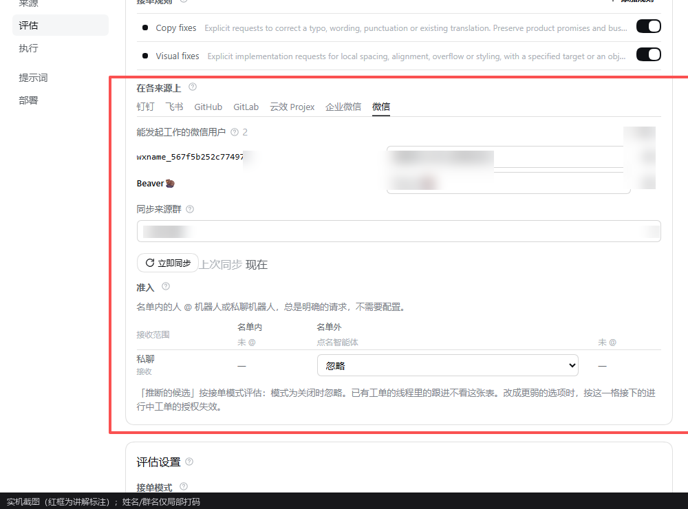
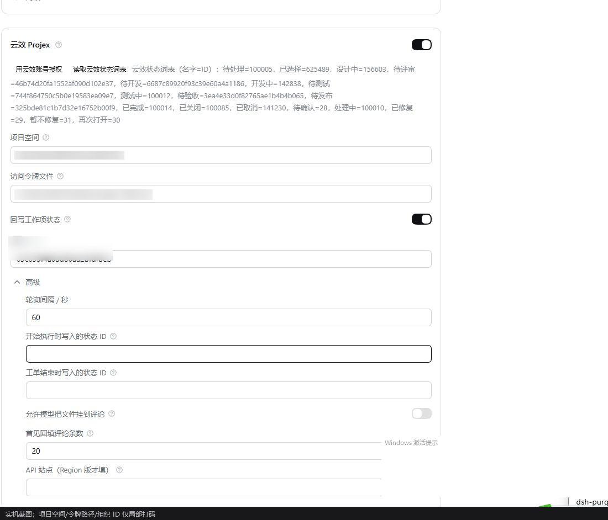
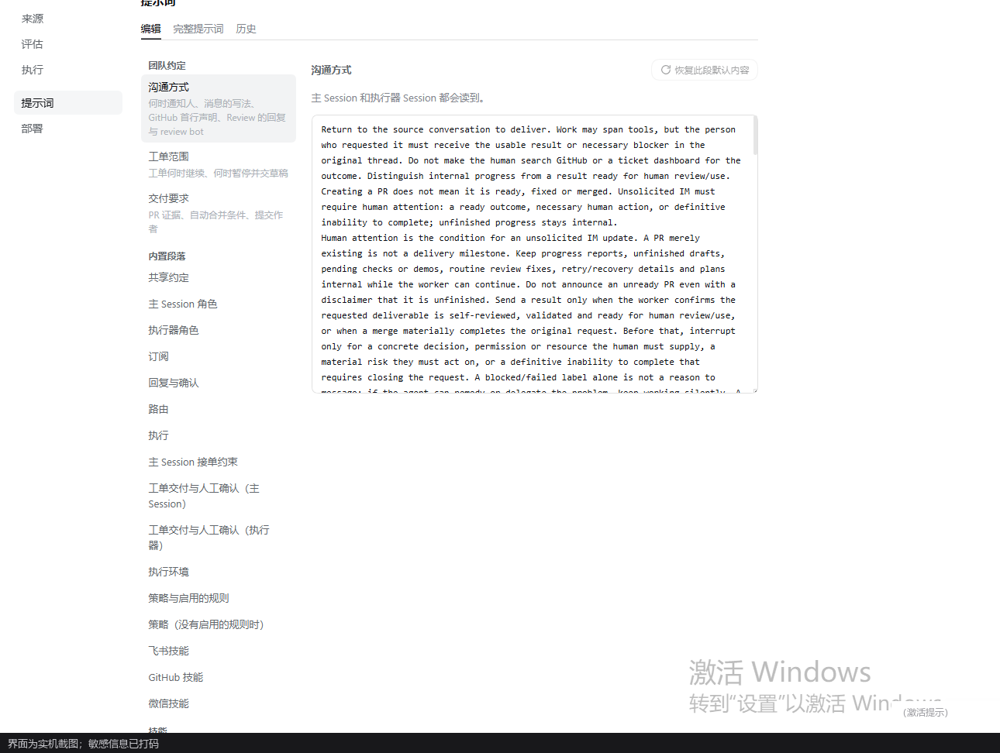

# 面板逐页说明

> 语言：[中文](005-panel.md) · [English](005-panel.en-US.md)

面板在侧边栏「Superagent 多通道」，与官方入口互不覆盖。左侧分栏固定为：**来源 / 评估 / 执行 / 提示词 / 部署**，顶部是**概览**。
下面的截图都是实机截图，敏感信息已打码。

## 概览

- 顶部统计：待办工单、评估中、被策略拦截的消息、回复失败等；点击数字跳到对应列表。
- 卡片会指出**下一步该做什么**（例如“某来源没有配置”“某条回复连续失败”），并给出可点的修复动作。
- 「打开主 Session」直接进入编排器的对话，便于人工接手。

## 来源

每个来源是一张卡片：

- 开关决定是否启用；未配置的卡片会说明「来源未启用 / 等待配置」。
- 卡片上有该来源的**动作**：飞书/GitHub 的检查、微信的「启动桥 / 停止桥 / 检查」、云效的「用云效账号授权 / 读取云效状态词表」、企业微信的检查等。
- 字段按需分组，凭据优先用 0600 文件；旧的字段会被标注迁移到新的位置（不会静默丢弃）。

以云效 Projex 为例：授权、状态词表、项目空间、令牌文件、状态回写与两个**状态下拉**（显示看板名字，存状态 ID）、轮询间隔、附件评论开关、首见回填条数、API 站点。

## 触发

- 按时间倒序列出收到的每条 Trigger：来自哪个来源/线程、谁发的、判定强度、去了哪条工单或为什么被忽略。
- 可点进线程查看上下文与原始消息；「重新评估」会把这条重新交给评估（不改变授权）。

## 评估

- 上半部是**策略**：规则开关（如 Copy fixes / Visual fixes，可自定义）、每个来源的「能发起工作的用户」名单、准入表（名单内/外 × 群里 @/未 @/私聊）。
- 下半部是**评估设置**：接单模式（关闭 / 仅观察 / 自动接单）、单次评估时限、研判模型与推理强度。
- 每次评估都会记录：判定、强度（explicit / inferred / quoted）、依据与耗时；「评估未完成」会显示原因而不是空白。

## 执行

- 进行中的工单、它们的执行器 Session、当前阶段（working / waiting / ended）。
- 每条工单可查看：任务说明、输入消息、执行器对话摘要、最新报告；可中断、可要求补充、可直接回复。
- 执行器只拿工单范围；文件交付在报告里以附件形式回到原线程。

## 提示词

- 主 Session 与执行器 Session 的每一段都可查看与覆盖；改动按版本保存，可对比历史、恢复默认。
- 六个来源技能各占一段：飞书、GitHub、微信、云效 Projex、企业微信、钉钉。

## 部署

- 显示当前 `stateDir`、数据库版本、健康检查结果、后台任务（桥、轮询器）的状态。
- 升级提示与迁移记录在这里；两台 superagent 并存时，各自显示自己的目录与锁。

## 截图与隐私

- 面板从不打印令牌；截图前仍建议检查姓名/群名/项目 ID，必要时打码后再发布。
- 本仓库 `docs/images/` 里的示例都已打码，替换示例时保持同样的打码标准。
