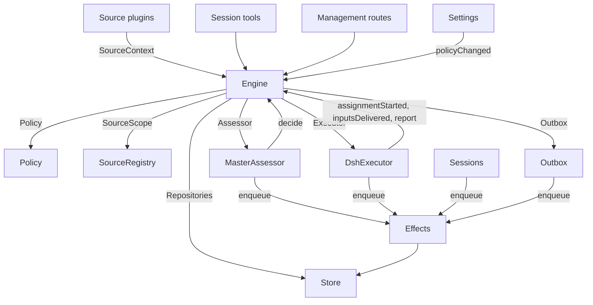

# 007 架构

> 语言：[中文](007-architecture.zh-CN.md) · [English](007-architecture.md)

这是实现层的开发者指南。它把 [001 Domain model](001-domain.md) 到 [006 Deployment](006-deployment.md) 中的概念映射到类、接口和文件。请先从运行时和引擎开始，然后把模块表和测试表当作代码索引使用。

## 核心类与胶水层

核心类以小接口的形式拥有领域概念和外部边界。胶水层把工具参数、HTTP 请求、来源载荷和 DeepSeek Harness 事件转换成对这些类的调用，再把结果转换成卡片、视图和消息。

`Runtime`（`src/app/runtime.ts`）构造应用、提供依赖，并负责启动和关闭。`Engine` 构造自己的内部部件。执行器和评估器会回调引擎，因此 Runtime 交给它们的是 getter，而不要求按环形顺序完成构造。

### Runtime

`Runtime` 是组合根；它不含任何领域规则。其构造函数锁定状态目录、打开存储并构建每个组件。若构建失败，它会关闭存储并释放锁。

启动流程注册管理路由并运行 Setup。setup 完成后，它安装会话钩子和执行器钩子、确保主会话存在、启动策略同步、恢复被中断的派工，并启动轮询和效果。`ready` 标记启动完成。

关闭流程取消轮次、等待轮询、效果和 agent 结束、还原进程环境、关闭存储并释放锁。来源插件通过窄接口 `SourceHost` 把 Runtime 作为 `orchestrator` 服务注入。

| 部件 | 模块 | 作用 |
| --- | --- | --- |
| Setup | `src/app/setup.ts` | 按工作进程 shell 运行 CLI 的方式探测它们，以此解析仓库和账号；写入并应用工作进程的环境和命令 shim，并保留 setup 问题；设置通过它检查变更后的账号，也通过它重启，而重启会再次运行 setup |
| Passes | `src/app/passes.ts` | 一次一轮，每两秒一轮，并在任何命令要求时运行：先处理到期的效果，再执行 `Engine.evaluateDue`；来源的触发通过它抵达引擎 |
| Outbox | `src/app/outbox.ts` | 引擎的 `Outbox` 端口，也是回执的唯一写入者：`send` 在同一个事务中保留消息的回执并把它的 `reply` 效果入队，该效果的处理程序通过 `SourceRegistry.send` 发送它；来源关闭时消息等待，会话已不存在或无人监听时消息被丢弃 |
| Notices | `src/app/notices.ts` | 把领域事件和工作进程活动转换成主会话消息。`eventNotice` 处理领域通知；`reportRelay` 立即转发提问，把普通进度留在其工单上，并转发其他报告；`followupRelay` 指明拥有人工跟进的那些工单。轮次进行期间到达的转发会在该轮次的下一个步骤通过 DeepSeek Harness 收件箱一起投递 |

### Engine

`Engine`（`src/core/engine.ts`）是触发、线程、决策、工单和派工的唯一写入者。它从 `src/core/ports.ts` 接收这些端口：`Repositories`、当前策略的 getter、`SourceScope`、`Assessor`、`Executor` 和 `Outbox`。可选依赖是 `prepareTicket`、`now` 和 `emit`。

引擎的所有方法都是同步的。每个命令在一个事务中修改自己的聚合。`evaluateDue` 为它修改的每个 Eval 或工单使用单独的事务。端口在事务内把外部工作入队；适配器在提交后执行它。无效请求抛出 `UserError`。

引擎暴露一个入口，并委派给五个内部部件。它拥有每个命令的事务。跨部件的命令（如 `attach`、`evaluateDue` 和 `policyChanged`）按顺序调用这些部件。

每个部件都继承 `EnginePart`（`src/core/part.ts`），后者提供选项和共享读取。部件之间的依赖单向流动：

| 部件 | 职责 | 依赖 |
| --- | --- | --- |
| `Intake` | 来源的触发：连同其处置一起只存一次，记录到它的线程及其关联上，扇出到已订阅的工单，并且（除非它是已抵达某个工单的人工消息）在其主线程上排队等待 Eval | 工单 |
| `Evals` | 线程的 Eval：批处理，门禁的强度，参与者与依据（连同赋予它们该依据的触发，即 `primary`），从候选投递起算的截止时间以及暂停带来的顺延，过期 Eval 的重新入队，候选、重放和交还，策略变更时的重新入队，以及每个 Eval 最终形成的决策：接受、停止、忽略或不可用 | 工单 |
| `Tickets` | 工单生命周期：由一次接受而创建（连同其授权、订阅和首个派工），它跟随的线程及其关闭（`followsDone`），被附加的线程与仅为上下文而跟随的线程，输入与备注，恢复以及恢复所拒绝的消息，重试、重启、停止和结束，它丢弃的订阅，以及把策略变更通知到受其影响的工单 | 回复 |
| `Assignments` | 执行器及其工作进程所报告的内容：派工已开始、输入已抵达或未能抵达、一次重启中断了它，以及工作进程的报告及其向人提出的问题 | 工单、回复 |
| `Replies` | 通过 `Outbox` 进行的渠道写入：确认、答复、结果和需要关注的消息，每一种都按其允许的规则进行 | 无 |

命令使用祈使式名称，如 `stopTicket`；适配器报告的事实使用过去式名称，如 `assignmentStarted`。查询 `candidate` 使用名词。

调用方只拿到引擎中属于自己角色的 `Pick`：`EngineForSources`、`EngineForMainSession`、`EngineForPeople`、`EngineForSettings` 或 `EngineForExecutor`。

| 角色 | 方法 | 效果 |
| --- | --- | --- |
| 来源 | `receive(trigger)` | 只存储一次触发，并回答 `stored`、`duplicate`，或在没有来源接收它时回答 `filtered`；把它扇出到订阅了其线程的工单，其中人工消息会立即恢复已结束的工单（除非处理已暂停），并在其主线程上排队等待 Eval，除非它是已抵达某个工单的人工消息——那种情况仍归该工单处理 |
| 来源 | `bindThread(ticketId, thread, own)` | 让一个未结束的工单跟随该来源的某个线程（例如某个 pull request 的线程），若该工单开启了它则为 `own`；再次绑定的已关闭线程会重新变为打开。结束工单的是线程的关闭，而不是 `ready` 报告 |
| 来源 | `threadClosed(thread, outcome, at)` | 一个线程关闭了：每个跟随它的未结束工单都记录该关闭，并在它对自己跟随的线程处理完毕（`followsDone`）后结束：它开启的线程没有仍处于打开状态的，或者，当它没有开启任何线程时，它跟随的每个线程都已关闭。它按那些关闭中最新的一个以 `merged` 或 `closed` 结束，除非：在关闭之后恢复的工作尚未报告 `ready`；或其执行器在其最新报告（`progress` 之外）或最后一轮次结束之后，通过确认或答复承接了某个人工跟进；随后一次 `dropped` 报告会像那次关闭一样结束它 |
| 主会话 | `candidate(triggerId)` | 持有某个触发的那个 Eval，按其评估器所看到的样子 |
| 主会话 | `candidateDelivered(evalId)` | 该 Eval 的候选已抵达主会话：其截止时间从现在起算 |
| 主会话 | `decide(triggerId, outcome)` | 记录一个 Eval 决策，或为显式请求记录一个直接决策。接受会以原子方式创建工单、授权、派工、订阅和确认。从卡片上被忽略的推断候选，会在所给原因之前记录 `ignoredFromCard`。当 `followupOwners` 仍拥有人工跟进时，只允许停止 |
| 主会话 | `attach(ticketId, triggerId, note?)` | 把某个触发路由到它所指向的工单，该工单的执行器随后把它作为跟进决策，并结束持有它的那个 Eval，该 Eval 的其他触发则等待一次新的 Eval；已结束的工单会在其授权下立即恢复（除非处理已暂停）。仍由某个执行器决策的跟进会被拒绝，被路由回交还它的那个工单的跟进同样会被拒绝 |
| 主会话 | `requestStatus(ticketId)` | 向等待中的执行器会话询问其状态，并回答是否发出了询问 |
| 主会话 | `note(ticketId, text)` | 把来自其他工作的事实作为文本输入交给工单的执行器，这不授予任何权限 |
| 主会话、执行器 | `reply(request)` | 为其用途所指名的渠道排队一条消息：`acknowledgement`、`answer`、`result` 或 `attention` |
| 人 | `stopTicket(ticketId, reason?)` | 人的停止操作，它会撤销授权 |
| 人 | `retryTicket(ticketId)` | 结束某个工单已停滞的派工并启动一个新的派工；该工单是在 `failed` 或 `blocked` 报告之后等待人工介入的，或其输入投递失败（`canRetry`） |
| 人 | `reevaluate(triggerId)` | 把已存储的触发排队等待一次新的 Eval |
| 人 | `unsubscribe(thread)` | 丢弃某个线程上的所有订阅，此前跟随它的工单不再跟随它；每个工单继续决策它在那个线程上收到的跟进 |
| 人 | `dismiss(decisionId)` | 忽略 `unavailable` 决策所显示的问题，该决策会记录这次忽略 |
| 执行器 | `assignmentStarted(ticketId, assignmentId)` | 派工开始运行；其等待中的输入被发出 |
| 执行器 | `inputsDelivered(ticketId, assignmentId, inputIds)` | 输入已抵达该派工的执行器会话，在其中各自等待某个步骤来取用它 |
| 执行器 | `inputsRead(ticketId, inputIds)` | 执行器会话把承载这些输入的消息收进自己的历史（一个 `user/message` 会话事件），其模型由此拥有它们；某个步骤曾认领它们但在之前被取消或失败的，不算数。只要其后跟随一次报告或一轮次的结束（重启之后亦然），每个输入就算作已读，且其工单的结束并不会让它失效；在读取记录存在之前投递的输入，只要在其投递之后跟随了一次报告或一轮次的结束，就算作已读 |
| 执行器 | `turnEnded(ticketId, assignmentId)` | 执行器会话的一轮结束了，在报告之后亦然，此时后台已无为其运行的东西，或它正交接给人。某个步骤此前取用的内容即已读（`inputsRead`） |
| 执行器 | `deliveryFailed(ticketId, assignmentId, error)` | 投递输入失败；工单会一直显示该失败，直到某次投递成功、新的派工开始或工单结束 |
| 执行器 | `report(ticketId, report)` | 记录一份报告及其向人提出的问题；`dropped` 会结束工单，`ready` 会完成一个不跟随任何线程的工单，并按线程结束的方式结束一个已处理完其所跟随线程的工单 |
| 执行器 | `markUnrelated(ticketId, thread, reason)` | 只丢弃该工单对某个被附加线程的订阅（它判定该线程无关），并连同原因交还它在那个线程上决策的跟进 |
| 执行器 | `followForContext(ticketId, thread)` | 为获取上下文，把一个未结束的工单订阅到一个相关线程：该线程的消息会到达工单，但不给它跟进强度，也不会恢复它 |
| 执行器 | `handback(ticketId, triggerId, reason)` | 记录该工单交还了一个抵达它的触发，并带上其候选所携带的原因；若确实由该工单决策，则在不再有其他工单决策它时把它排队等待一次新的 Eval；它回答是否已入队。一个工单对每个触发只交还一次，并保留其订阅 |
| 执行器 | `assignmentInterrupted(ticketId, assignmentId)` | 宿主停止时某个派工正在运行：在工作中途被中断的派工，或在其最新报告之后收到输入的派工，会带着一条恢复备注以及那些已投递给它但执行器会话未取用的输入重新开始，如同一次重试；此后已报告过的派工保留其会话。DshExecutor 在启动时（`resume`）逐个报告它们，最旧的工单优先，并把处于等待中的启动再次入队 |
| 轮询 | `evaluateDue()` | 除非处理已暂停：为那些排队触发在等待的线程启动 Eval，每个线程一个，期间排队的触发作为一个批次；把已过截止时间的 Eval 的触发重新入队，连续两次，第三次则将其记录为 `unavailable`；并恢复那些在暂停期间收到人工消息的已结束工单，前提是其授权仍然有效。候选尚未抵达主会话的 Eval 不会过期。处理暂停期间没有 Eval 过期，一旦恢复，每个截止时间都按暂停时长顺延 |
| 设置 | `policyChanged(from, to, effects)` | 告诉每个受影响的活跃工单该变更如何影响它（`src/policy.ts` 中的 `policyEffects`：它被接受时所依据的规则已变更或不再适用、其请求方可能已无法发起工作，或主动工作已不再被接受），并按新版本重启进行中的 Eval |

引擎把批处理、授权、扇出、恢复和关注生命周期这些规则保持私有。几个共享谓词让这些规则保持一致：

- `waitsForPerson`（`src/core/model.ts`）：最新的派工报告了 `blocked` 或 `failed`，且此后没有人工消息到达。只要该条件成立，自动输入和失败的启动就一直被挂起。
- `followupOwners`：仍对其自己线程上收到的人工跟进负责的那些工单。工单可以是活跃的，也可以是未经人工停止而结束、正等待恢复的。交还该消息即结束该归属关系。
- `settled`：某个决策已解决了该请求；停止、不可用、已路由和被拒绝的停止这几类决策不算数。
- `ticketStage`（`src/core/stage.ts`）：实现 [003 Execution](003-execution.md) 中的阶段表。

工单结束时，未读的跟进会回到 Eval，除非另有工单仍拥有它们，或另有处置已解决它们。已确认、已答复和已交还的消息被排除在外。对于没有确认处置的较旧记录，发件箱回执提供该事实。最终报告还涵盖派工开始时正在等待的消息，包括恢复它的那条消息。停止工单的那条消息不会被自动重新评估。

每次变更后，引擎从 `src/core/ports.ts` 的 `DomainEvents` 中发出一个事件：

`trigger.received`、`eval.started`、`decision.recorded`、`ticket.created`、`ticket.resumed`、`ticket.ended`、`assignment.started`、`assignment.ended`、`thread.subscribed`、`thread.unsubscribed`、`trigger.requeued` 或 `policy.changed`。

Runtime 把 `ticket.ended`、`trigger.requeued` 和 `thread.unsubscribed` 转成通知。投递给工单的人工 `trigger.received` 会变成一次跟进转发。`pullEndNotices` 在工单以 merged 或 closed 结束时，用一个稳定的 id 发送一条聊天通知。其他事件目前没有消费者。

### Model

`src/core/model.ts` 存放领域类型，`src/core/stage.ts` 存放工单阶段。决策把原因记录为 `reason`，即 `Reason` 的列表（`src/core/reasons.ts`）：每个 `Reason` 是一个 `code` 及其 `values`，并且对于批次中的单个触发，还带其 `triggerId`。

核心自带的代码（如 `timeout`、`policyChanged`、`routed` 和 `startedTicket`）都在 `REASONS` 中，并带有 agent 通过 `reasonText` 读取的英文表述；门禁或来源作用域给出自己的代码，如 `not_a_member`；`said` 承载评估器或人写下的文字。面板按 `reason.<code>` 为每个代码取词，被来源过滤掉的触发也以同样方式记录该来源的代码。

工单对每个事实只保留一份。它没有 `ended` 时即为未结束，`ended` 记录它何时、由谁、为何以及以什么结果结束；它最后说的话是它最新的派工报告（`latestReport`）；它的执行器会话以它命名（`src/executor/dsh.ts` 中的 `workerSessionId`）。

它的字段都是有类型的：`origin`，即赋予其 Eval 批次强度的那个可准入触发以及该批次本身（`triggerId`、`triggerIds`）；`execution`，执行器所选的内容（`name`、`directory` 和 `assignment`）；`delivery`，最后一次失败的输入投递（`error`、`at`），一直保留到某次投递成功、新的派工开始或工单结束；以及 `follows`，来源让它跟随的线程，每个为 `{thread, own, closed?}`：工单开启它时为 `own`，一旦关闭则 `closed` 连同 `at` 和 `outcome`。只有工单会写 `follows`；GitHub 来源用 `pullsOf` 和 `pullOf`（`src/sources/github-pull.ts`）读取它的 pull request。

承载触发的输入会记录它是否由人写成，`waitsForPerson` 会读取这一点。线程还在 `context` 中列出仅为上下文而跟随它的已订阅工单，并在 `expired` 中累计其排队触发的 Eval 连续过期的次数；一个评估记录其 `primary` 触发以及其候选何时被 `delivered`。

触发的处置记录它通过扇出或附加而抵达的工单、某个人发起的重新入队、每个交还它的工单（连同原因），以及每个其执行器确认或答复了它的工单。

授权的 `basis`（`MandateBasis`）记录门禁如何准入它的触发。重新校验读取接收方的 `source`、`scope` 和 `row`，被列出的 `sender`、匹配到的 `rules`，以及 `via`：

| `via` | 准入依据 |
| --- | --- |
| `addressed` | 一个被允许的发送方对 agent 发话 |
| `followup` | 某条消息到达了一个有工单的线程 |
| `admission` | 一个准入表单元格；`observation` 标记推断出的候选 |
| `bot` | 一个被列出的 bot 产生了推断出的候选 |

触发和线程的 `meta` 属于来源。核心不解释它们。

### Policy

`src/policy.ts` 定义设置模式、授权规则和评估规则。`settingsPolicy(settings, scope)` 每次使用时都返回一个新的、无状态的 `Policy`：

- `version`、`paused` 和 `evalTimeoutMs` 描述它的当前状态。
- `gate(trigger, thread, tickets)` 返回准入强度和依据。
- `revalidate(mandate)` 检查既有授权是否仍然有效。
- `admitsInferred(rules)` 仅在有启用的匹配规则的自动模式下允许主动接受。

`assessmentOutcome(assessment, settings, strength)` 把模型的评估转换成引擎的结果。它要求对每条启用的规则都有判断、方向已定、存在匹配的规则，以及意图的证据。在自动模式之外，推断出的接受会变成一条“would accept”记录。

`policyEffects(tickets, old, now, scope)` 指出一次变更影响哪些未结束的工单以及如何影响。`Engine.policyChanged` 只通知这些工单。`policyVersion` 对规则、接受模式以及各来源的策略部分（含 bot 列表）做哈希。

### Store

`Store`（`src/app/store.ts`）拥有一个 SQLite 数据库。Runtime 在打开它之前先获取目录锁，从而防止第二个进程迁移或写入同一份状态。

它的接口按用途分组：

- **领域仓储：** `atomic`，加上 `triggers`、`threads`、`tickets` 和 `decisions`，每个都有 `get`、`save` 和列表查询。带索引的工作集是 `threads.active()`、`tickets.open()`、`tickets.active()` 和 `read.subscribedThreads`。
- **读取查询：** `read` 通过 `threadTriggers`、`triggerStats`、`search` 和 `droppedReplies` 之类的方法为视图、工具和来源轮询服务。这些方法从不写入。
- **来源元数据：** `threads.describe` 和 `threads.patchMeta` 更新来源拥有的线程元数据。
- **设置：** `settings`、`saveSettings`、`blockRevision` 和 `settingsHistory`。设置和提示词使用带编号的 `Versions`（`src/app/versions.ts`）。
- **发件箱回执：** `replyStatus` 和 `receipts`，只由发件箱写入。回执操作有 `get`、`waiting`、`behind`、`add`、`settle` 和 `withdraw`。`behind` 检查同一工单和同一会话的较早消息是否在失败次数少于三次的情况下仍在等待。被撤回的消息以 `channelGone` 或 `channelIgnored` 结清。读取查询通过 `failingReplies`、`droppedReplies` 和 `droppedSince` 暴露失败和丢弃的回复。
- **带类型的键值记录：** `get`、`set`、`delete` 和 `keys`，使用来自 `KV` 的条目。

`afterCommit` 只在事务提交后运行动作，回滚后绝不运行。Runtime 以记录存储时的形态读取它们；schema 11 迁移在启动时转换较早的受支持记录。

### Effects

`Effects`（`src/app/effects.ts`）是持久化的副作用队列。命令在其事务内调用 `enqueue(kind, key, payload)`；执行只在提交之后开始。

每个 kind/key 组合对应一行。对同一个仍在等待的 key 再次入队会替换其载荷并使其立即到期，且不改变队列顺序。`handle(kind, run, options)` 为每个 kind 注册一个处理程序。它按从旧到新的顺序处理到期的行，直至并发上限。

失败会以指数退避重试。抛出 `Later` 会推迟工作且不计为失败，例如在没有可用工作进程槽位时。`start` 在 setup 之后开始处理，`drain` 在关闭期间停止处理但保留待处理的行，`pending`/`idle` 暴露队列状态。

| 类型 | 处理程序 | 作用 | 同时并发 | 重试 |
| --- | --- | --- | --- | --- |
| `assessment` | MasterAssessor | 把一个 Eval 的候选卡片引导进主会话的轮次，然后告诉引擎它已投递，从而启动该 Eval 的截止时间 | 4，暂停期间为 0 | 2 秒起，逐次翻倍至 60 秒 |
| `launch` | DshExecutor | 启动一个待处理的派工：准备命令、执行器会话、派工消息 | 空闲的工作进程槽位数，暂停期间为 0 | 模型提供方或网络的暂时性失败在 5 秒后重试，逐次翻倍至 300 秒，共三次；其他任何失败，以及准备命令失败，都会使其工单失败。因暂停或槽位已满而被挂起的，会在 5 秒后重试 |
| `delivery` | DshExecutor | 把工单等待中的输入按顺序交给其正在运行的派工 | 4，暂停期间为 0 | 2 秒起，逐次翻倍至 60 秒；等待工作进程槽位的，在 2 秒后重试 |
| `relay` | Sessions | 把工作进程的报告或提问，或某个人的跟进，引导进主会话的轮次 | 1，按队列顺序 | 2 秒起，逐次翻倍至 60 秒 |
| `notice` | Sessions | 向主会话注入一条通知而不唤醒它 | 1，按队列顺序 | 2 秒起，逐次翻倍至 60 秒 |
| `reply` | Outbox | 通过其来源为某个渠道发送消息，且在该工单发给该会话的、失败未达三次的较早消息之后；撤回该消息会取消它 | 1，暂停期间为 0 | 5 秒起，逐次翻倍至 300 秒；来源关闭或排在较早消息之后的，在 5 秒后重试 |

每个 kind 都在自己的名字下有一个健康条目。当其某个效果连续失败三次时它会报告错误，但 `delivery` 除外——它的失败改为显示在其工单上。转发保持顺序，通知也是如此；一个失败的会阻塞其后同类型的项。

### Sources

来源通过 `SourceKind` 扩展宿主，`SourceKind` 定义在 `src/sources/kind.ts`。一个 kind 声明它的身份、标题、描述、配置 `schema` 和 `fields`、派生的 `facts`，以及 `health` 条目。可选行为包括 `scope`、`channel`（`allowed`、`send`、`link`）、`threadContext`、`find`、`policy`、`environment` 和 `refreshLabels`。

`SourceRegistry`（`registry.ts`）拥有已注册的 kind 和已存储的实例，并实现引擎的 `SourceScope`。注册会在 `HealthBoard` 上认领健康条目；重复认领和保留的 `sync:` 名称会被拒绝。SourceContext 只通过其注册所认领的条目写入，因此注销之后的报告不会产生任何效果。

注册表的配置方法包括 `kind`、`instances`、`instance`、`validate`、`validatePolicy`、`policyPart`、`channelAllowed`、`declarations`、`environments`、`find` 和 `scope`。`find` 会询问每个支持搜索的 kind。

通用代码通过注册表访问来源行为。`send(message, commands)` 调用该 kind 的渠道，并返回 `sent`、`gone`，或在该 kind 未安装时返回 `waiting`。`link` 解析其渠道链接。`threadContext` 把 kind 的读取器与其配置配对，当该 kind 没有读取器时不返回任何内容。存储的配置无效会使该实例被禁用。

插件收到的是 `SourceHost`：注册表以及 `context(kind)`。kind 自身使用更窄的 `SourceContext`，它由 `src/app/source-context.ts` 中的 `sourceContextOf` 构建。

该上下文提供部署与命令、setup 就绪状态（`ready`、`configured`、`problem`）、配置、`receive`、`atomic` 以及带类型的 `state`。它还暴露线程读取与元数据写入、工单读取与绑定/关闭命令、触发读取、经发件箱的 `notify`，以及针对已声明健康条目的 `report`。

### DshExecutor

`DshExecutor`（`src/executor/dsh.ts`）为每个工单提供一个会话和一个目录。`start` 和 `deliver` 分别把 `launch` 和 `delivery` 效果入队。`stop` 通过 `Store.afterCommit` 取消轮次，因此被回滚的结束不会停掉工作进程。

`prepare(ticket, outcome)` 提供引擎的 `prepareTicket` 钩子：短名称、目录和 `ticketExecution` 派工文本。`workerSessionId(ticket.id)` 派生出会话 id。

`WorkerSlots` 在启动之前，或在唤醒空闲工作进程的投递之前预留容量。人工消息可以在 `maxWorkers` 之外多用一个槽位，唤醒优先于启动。`activeCount` 为面板负载提供数据。

提供方和网络的暂时性失败会重试三次。启动沿用效果的退避；失败的轮次会在 15、30 和 60 秒后收到续接消息。`inputMessage` 依据当前工单状态渲染每个输入，`mandateInstructions` 加上推断性工作的匹配规则限制。

`install` 订阅会话事件；`dispose` 取消订阅。轮次结束通常报告等待中，但在就绪之后或在需要人工操作期间除外。错误则报告 failed。启动时，`resume` 通过 `assignmentInterrupted` 报告被中断的派工，并重新入队那些不等待人工的待处理启动，最旧的工单优先。

### MasterAssessor

`MasterAssessor`（`src/app/assessment.ts`）让主会话评估主动候选。`request` 把评估效果入队；`release` 在其 Eval 结束时丢弃缓存状态。

它的 `context`、`read` 和 `decide` 方法服务于 `orchestrator_eval`、`orchestrator_eval_read` 和 `orchestrator_eval_decide`。它们通过 `SourceRegistry.threadContext` 提供有界的线程上下文、仓储上下文，以及决策提交。没有上下文读取器的 kind 只提供触发和批次。

`assessmentOutcome` 把模型的回答转换为 `Engine.decide` 所需的形式。Evals 会再次用当前策略校验推断出的接受。

### Settings

`Settings`（`src/app/settings.ts`）读写带修订号的设置块。`current` 和 `view` 读取它们；`save(block, value, revision, origin)` 校验一次保存；`pause(paused, origin)` 修改独立的 `paused` 设置。

每次保存都声明其来源：`panel`、`tool` 或 `sync`。只有 `panel` 能修改执行环境或 `SETUP_FIELDS`（`src/deployment.ts`）中列出的字段。

策略版本变更会计算 `policyEffects`、记录哪些工单被通知，并调用 `Engine.policyChanged`。`syncable` 和 `sync(id)` 刷新某个来源的策略部分。`refreshLabels(id)` 刷新显示名称。

### Prompts

`Prompts`（`src/app/prompts.ts`）把配置存储为 `Versions`。`current`、`version` 和 `history` 读取它们；`validate`、`preview` 和 `save(value, baseRevision, source)` 检查并保存它们。`compose` 和 `skills` 构建会话文本。

`builtInParts` 列出覆盖键、角色、默认文本和必需的模板占位符。每个覆盖项存储团队 `text` 和一个 `base`：其原始默认值的 `builtInBase` 键。保存会把该默认值保留在 `KV.prompts.builtIn` 之下。`defaultChanged` 随后报告已变更的默认值、可用时它们的旧文本，以及已移除的部件。

校验会从已保存的覆盖项继承省略的 base，丢弃已保存数据中仍然存在的已移除部件，并拒绝空白文本或其他未知键。这使保存工具能对它读取到的配置做往返保存。`environmentSection` 和 `policySection` 只使用自有键，一次性替换模板值。没有覆盖项的配置使用默认值。

### Sessions

`Sessions`（`src/app/sessions.ts`）为两种角色管理 DeepSeek Harness 会话。`ensure` 用其角色的模型创建一个会话。`install` 跟踪 agent 事件，并为受管会话注册提示词、技能和工具。

`prompt` 每个请求 id 只投递一次。`relay` 和 `notify` 把主会话消息入队，由 `relay` 和 `notice` 效果处理。`src/app/notices.ts` 定义它们的内容；`delivery` 检查消息是否已抵达。

每次模型请求都会把会话绑定到当前的提示词修订版。它用过的修订版被持久保存：`promptVersion` 标识生效的那一个，`mayRead` 限制工作进程可以查看哪些版本。注册情况按 agent 分别记录在一张映射表中。

`status` 和 `promptVersion` 为提示词页面服务。保存经由 `Prompts.save` 并通知主会话。`modelRetry` 暴露模型预算的重试状态。

### 胶水层

| 胶水层 | 转换内容 |
| --- | --- |
| `src/app/runtime.ts` | 组合根：用各部件所使用的接口构建它们，注册路由和来源宿主，并启动和停止 dsh-superagent |
| `src/app/notices.ts` | 把领域事件和工作进程报告转换成给主会话的通知和转发 |
| `src/app/tools/main.ts`、`src/app/tools/executor.ts` | 把主会话和执行器会话的工具参数转换成核心类的调用，并把它们的结果转换成卡片 |
| `src/app/http.ts`、`src/app/views/`、`src/app/api.ts` | 把 HTTP 请求转换成调用，把存储读取转换成面板的视图；`api.ts` 为面板给每条路由定类型 |
| `src/app/resources.ts`、`src/app/links.ts`、`src/app/cards.ts` | 把资源名转换成读取、把来源消息转换成链接、把记录转换成给模型的紧凑卡片 |
| `src/sources/github*.ts`、`src/sources/feishu*.ts`、`src/sources/poll.ts` | 把 GitHub 和 Feishu 载荷转换成触发和线程事实，把消息转换成 CLI 调用 |
| `src/deployment.ts`、`src/setup.ts`、`src/infra/` | setup 探测与问题、CLI 传输、agent 的进程环境 |

## 依赖规则

- **显式、窄的依赖。** 每个类都收到一个接口，该接口指明它用到的东西，大多表现为其他类的 `Pick` 类型：核心类用 `ExecutorHost`、`AssessorHost`、`SessionsHost`、`SettingsHost`、`SetupHost`、`PassesHost` 和 `OutboxHost`，胶水层用 `HttpHost`、`MainToolsHost`、`ExecutorToolsHost`、`ResourceHost`、`LinkHost` 和 `SourceContextDeps`，而引擎则以调用它的那个角色的 `Pick` 形式出现。Runtime 只在这种接口之后传递自身。来源插件注入 `orchestrator` 服务，其类型把它命名为 `SourceHost`：注册表以及 `context(kind)`；其 kind 的代码只看到自己的 `SourceContext`。
- **谁能 import 谁。** `src/core` 除 Node 的哈希外不 import 自身之外的任何东西，也不做任何 I/O。`src/sources` 不从 `src/app` import 任何东西。面板只从宿主侧 import 类型，以及 `src/admission.ts`、`src/limits.ts`、`src/setup.ts`、`src/navigation.ts`、`src/sources/host.ts`、`src/core/errors.ts`、`src/core/reasons.ts` 的纯值和 `src/app/api.ts` 的过滤列表。
- **每种状态只有一个写入者。** 每种状态只有一个写入者，其他人读取它或向该写入者询问。

  | 状态 | 写入者 |
  | --- | --- |
  | 触发、线程、决策、工单、派工 | 引擎 |
  | 来源的读取位置，以及它在其线程上保留的 meta（`label`、`url`、`facts` 及其自有键） | 该来源，通过 `SourceContext` |
  | 设置及其历史 | 设置 |
  | 提示词版本 | 提示词 |
  | 效果行 | 效果 |
  | 发件箱回执 | 发件箱：引擎的消息和来源的 `notify` 都经过它的 `send`，并由它的 `reply` 效果标记 |
  | 健康条目 | 在 `HealthBoard`（`src/infra/health.ts`）上认领它的那个部件，该板拒绝第二次认领：`runtime` 是 Runtime，轮询通过它上报；`evals` 是每轮巡检之后的 Runtime；`models` 是会话；每个效果 kind 是效果；`worker` 是 DshExecutor；某个来源 kind 的条目是该 kind 对应来源的 SourceRegistry；`sync:<id>` 是设置 |

  来源只通过 `SourceContext.tickets.bindThread` 和 `threadClosed` 修改工单，这两个方法会调用引擎。
- **请求与事实。** 请求某事的方法以祈使动词加宾语命名，如 `stopTicket` 或 `bindThread`，并且可能被拒绝；记录适配器做了什么的方法用过去式命名，如 `assignmentStarted` 或 `deliveryFailed`。每个宿主都以自己需要的角色类型接收引擎。
- **带类型的字段，来源数据放在来源之下。** 代码读取工单和授权的带类型字段。来源不在工单上保留任何东西：工单跟随它的哪些线程是工单的 `follows`，而它关于某个触发或线程所保留的内容在它们的 `meta` 中。
- **固定的拒绝。** 人或 agent 可以触发的拒绝是来自 `src/core/errors.ts` 中 `USER_ERRORS` 的 `UserError(code, values)`。管理 API 对 `missing` 代码返回 404，对其他代码返回 400，面板用其语言为每个代码取词。setup 问题是 `SetupError` 代码（`src/setup.ts`），固定的健康文本是 `HealthCode`（`src/sources/host.ts`），取词方式相同。
### 来源特定的依赖

有些通用模块仍然直接引用 GitHub 或 Feishu：

- 发件箱应用 Feishu 聊天字数上限。
- `src/app/links.ts` 解析 Feishu 消息链接和 `repliedTo`。它和 Runtime 用 `feishuSettings` 读取设置。
- `src/app/resources.ts` 读取 `feishu/` 和 `github/` 的原始资源；`src/app/cards.ts` 为工单卡片使用 `pullOf`。
- Runtime 为 merged 或 closed 的工单发送 `pullEndNotices`。
- 执行器工具用 `readPull` 和 `claimPull` 绑定被报告的 pull request，使用 Runtime 暴露的 GitHub 上下文。
- MasterAssessor 用 `readRepositoryPath` 读取仓库文件。
- Sessions 和 Prompts 只为 GitHub 和 Feishu 注册内置技能。迁移会转换它们的 schema-10 记录。
- Setup 只探测 GitHub 和 Feishu 的账号字段（`SETUP_FIELDS`）。只有这些来源通过 `SourceContext.problem` 收到账号 setup 问题。

<!-- part2: merge with part1 before publishing -->
## 模块

| 路径 | 职责 |
| --- | --- |
| `src/index.ts` | 主插件入口：读取机器设置，启动 Runtime，并为其提供保存某个来源账户时所用的重启 |
| `src/deployment.ts` | 插件的 `Config` 与 `Machine`；`resolveDeployment` 和 `resolveFeishuBot` 从来源设置中读取仓库和账户，每次 CLI 均按执行器 shell 的方式运行；`SETUP_FIELDS` 列出设置过程所读取的来源字段。代码中不指定任何个人、账户或组织 |
| `src/setup.ts` | 设置问题：`SetupError`，带有错误码、修复它的位置，以及日志、主会话和面板共用的英文文本 |
| `src/policy.ts` | 策略：按块划分的设置 schema、策略版本、门禁以及 Mandate 复核 |
| `src/admission.ts` | 准入表的值、每个单元格的选项和默认值，与面板共用 |
| `src/limits.ts` | 用户所设值的限制，由设置 schema 校验，并由面板的字段提供 |
| `src/kv.ts` | `KV`：每一族 `kv` 记录及其键、值类型和所有者，以及存储和 `SourceContext.state` 使用的 `Key` 和 `Family` 类型 |
| `src/app/lock.ts` | 状态目录的锁：每个状态树一个 dsh-superagent，stale 窗口足够短，使重启时不会认为上一进程的锁仍然有效 |
| `src/navigation.ts` | 一旦宿主目录列出某个 DeepSeek Harness 会话，便从面板打开它 |
| `src/core/model.ts` | 领域类型，其中包括带类型的工单和 `MandateBasis`，以及 `threadKey`、`ticketOutcome`、`reached`、`followupOwners`、`settled`、`waitsForPerson`、`liveTicket`、`runningAssignment`、`latestAssignment` 和 `latestReport` |
| `src/core/ports.ts` | 端口：`Repositories`、`Policy`、`SourceScope`、`Assessor`、`Executor`、`Outbox`，以及领域事件 |
| `src/core/engine.ts` | 引擎，核心的入口点，以及角色接口 `EngineForSources`、`EngineForMainSession`、`EngineForPeople`、`EngineForSettings` 和 `EngineForExecutor` |
| `src/core/part.ts` | `EnginePart`，引擎各部分的基类，以及 `EngineOptions` |
| `src/core/intake.ts` | `Intake`：将来自来源的触发归入其工单，并在某人的消息未到达工单时将其归入 Eval |
| `src/core/evals.ts` | `Evals`：线程的 Eval 及其决策 |
| `src/core/tickets.ts` | `Tickets`：工单生命周期、工单所跟随的线程、订阅和输入 |
| `src/core/assignments.ts` | `Assignments`：执行器的事实及其工作者的报告 |
| `src/core/replies.ts` | `Replies`：引擎对 Channel 的写入 |
| `src/core/stage.ts` | `ticketStage` 和 `canRetry`：[003 Execution](003-execution.md) 中的工单阶段 |
| `src/core/errors.ts` | `UserError` 和 `USER_ERRORS` |
| `src/core/reasons.ts` | `Reason`、`REASONS` 和 `reasonText`：核心记录某个决策或搁置某个触发的原因，按错误码给出 |
| `src/core/ids.ts` | `key`：由输入派生的 id，相同输入得到相同 id |
| `src/core/memory.ts` | `MemoryRepositories`：内存中的存储仓库，按存储的顺序排列并具备其嵌套回滚，用于领域测试 |
| `src/core/index.ts` | 核心的导出 |
| `src/app/runtime.ts` | Runtime，组合根，及其启动与停止 |
| `src/app/setup.ts` | 设置，以及 `setupChanged`——某次保存是否改变了设置过程所读取的字段 |
| `src/app/passes.ts` | Passes，pass 调度器 |
| `src/app/outbox.ts` | Outbox：引擎的 `Outbox` 端口、回执，以及发送这些回执的 `reply` 效果 |
| `src/app/notices.ts` | 主会话的通知与转发：`eventNotice`、`reportRelay`、`resultRelay` 和 `followupRelay` |
| `src/app/store.ts` | 存储，以及 `Receipt`——outbox 中的一条消息 |
| `src/app/store-read.ts` | `storeReads`：供视图、工具和来源轮询使用的存储读取查询，从不写入 |
| `src/app/migration.ts` | schema 11 迁移：从 schema 10 一步迁移，将每条存储记录写为其当前形态 |
| `src/app/effects.ts` | 效果 |
| `src/app/versions.ts` | `Versions`：以带编号的快照保存的记录，并指向当前快照，用于设置和提示词 |
| `src/app/cache.ts` | `TextCache`：在内存中按大小限制保存的文本，最先丢弃最久未使用的 |
| `src/app/settings.ts` | 设置 |
| `src/app/settings-history.ts` | `policyHistory`：每次保存的设置修订，以及它相对上一修订的改动 |
| `src/app/prompts.ts` | 提示词、`builtInParts`（团队可覆盖的内置部分），以及 `promptParts`（某个角色的提示词各部分的顺序） |
| `src/app/context.ts` | 内置提示词文本（从 `prompts/` 读取），以及会话所读取的记录条目 |
| `src/app/skill-files.ts` | 打包文本：`promptFile`（将文件中的单句行合并为段落），以及随包附带的技能 |
| `src/app/sessions.ts` | 会话 |
| `src/app/delivery.ts` | `AgentDelivery`：按请求 id 向 DeepSeek Harness 代理投递一次消息，跨恢复的会话亦然 |
| `src/app/retry-health.ts` | `RetryHealth`：哪些会话在等待模型预算重试，供 `models` 健康条目使用 |
| `src/app/role-models.ts` | 解析 Eval 和执行器的模型，并为新会话以其角色对应的模型进行初始化 |
| `src/app/assessment.ts` | MasterAssessor、评估 schema，以及 `orchestrator_eval` 所回答的窗口 |
| `src/app/execution-environment.ts` | 执行环境：其变量、工单的值、目录根，以及提示词部分的各行，由 `src/app/prompts.ts` 填入其模板 |
| `src/app/source-context.ts` | `sourceContextOf`：每种来源类型的 `SourceContext` |
| `src/app/links.ts` | `sourceLink`（触发消息所在的页面），以及 `candidateCard` |
| `src/app/cards.ts` | 供模型使用的触发、工单、线程和决策的紧凑卡片、工单卡片状态的封闭集合 `TICKET_STATES`，以及 `textPage` |
| `src/app/resources.ts` | `RESOURCES` 和 `readResource`：`orchestrator_read` 为各角色读取的内容 |
| `src/app/tools/tool.ts` | `Tool` 类型、`readTool`、两种角色的 `orchestrator_read`，以及 `AcknowledgementSchema` |
| `src/app/tools/main.ts` | 主会话的工具 |
| `src/app/tools/executor.ts` | 执行器会话的工具 |
| `src/app/http.ts` | `/orchestrator/api` 路由：同源检查、请求限制，以及每种失败对应一个状态码 |
| `src/app/api.ts` | `Api`，每条路由及其参数、查询、请求体和响应，以及列表的过滤器；它仅导入类型，因此面板可将其打包 |
| `src/app/views/text.ts` | 视图文本的两种形式：`preview`（单行纯文本）和 `markdown`（不含 HTML）；`plain` 和 `readable` |
| `src/app/views/records.ts` | 视图共用的行：触发、工单、线程、决策和 Channel 链接，以及 `ownersOf`——在一次请求读取时后续跟进的所有者 |
| `src/app/views/tickets.ts` | 按阶段划分的工单列表、工单页面、Mandate 依据事实以及执行器的负载 |
| `src/app/views/threads.ts` | 线程列表、线程时间线、搜索以及决策列表 |
| `src/app/views/sources.ts` | 来源状态：每个来源实例的状态、其最后一天的计数，以及当天它过滤和丢弃的内容 |
| `src/app/views/settings.ts` | 设置页面的视图：每个块及其修订、每个来源的设置及其类型的表单，以及执行环境 |
| `src/app/views/overview.ts` | 概览：需要人处理的工单、问题、最后一天的流转以及执行器的负载 |
| `src/executor/dsh.ts` | DshExecutor、`WorkerSlots`、`ticketExecution`、`inputMessage` 和 `mandateInstructions` |
| `src/executor/background.ts` | 工作者在 DeepSeek Harness 中的后台工作、其会话拥有的 shell 作业（`ctx.jobs`）及其子代理（`ctx.subagents`）：`runningJobs`、`untilQuiet`、`killJobs`、`collectJobs`、`stopSubagents`、`stopBackground`、`until`，以及 `cancelled`——因停止其子代理而取消轮次的工作者 |
| `src/infra/commands.ts` | `Commands`，CLI 传输：`run`；`api` 和 `pages`（限于已配置的仓库并经过校验）；`lark`（作为机器人）；`git`。`CliError` 携带命令输出所报告的错误码，例如某个 GitHub HTTP 状态；无任何输出的命令以其结束方式失败，绝不以它的参数失败；`validItems` 跳过并统计列表中的格式错误项 |
| `src/infra/environment.ts` | 代理的进程环境：命令 shim、git 配置和凭据助手、`runAsWorker`，以及对环境和工单目录的检查 |
| `src/infra/paths.ts` | 包的根目录，即打包文件所在位置 |
| `src/infra/text.ts` | 字数统计和聊天消息限制、`fill` 和 `sameName` |
| `src/infra/health.ts` | `HealthBoard`，每个部分的健康条目，各由其唯一写入者认领 |
| `src/infra/secret-file.ts` | 机密文件的唯一"仅所有者"规则：`readSecretFile` 和 `requireOwnerOnly`，在平台具备 POSIX 位时执行 `0600` 检查，报出被拒文件实际拥有的模式，并将 Windows 交由 ACL 处理 |
| `src/infra/hosting-api.ts` | 代码托管 HTTP 客户端：`HostingApi` 和 `createHostingApi`，令牌从其 `0600` 文件读取，`PRIVATE-TOKEN`，白名单化的 `/projects` 路径，以及 30 秒超时 |
| `src/infra/yunxiao-api.ts` | 云效 HTTP 客户端：`YunxiaoApi`、`createYunxiaoApi` 和 `YunxiaoHttpError`，每次调用都读取其令牌文件，`/oapi/v1/` 路径限制和组织白名单，JSON 与 multipart 请求体，以及遇到 401 时先续订一次 OAuth 令牌再重试 |
| `src/infra/yunxiao-oauth.ts` | 云效 OAuth 2.0 登录：授权服务器元数据发现、动态客户端注册、PKCE S256、127.0.0.1 回环回调、令牌交换与刷新，以及插件其余部分已经读取的"仅所有者"令牌文件（其旁附有刷新材料） |
| `src/sources/kind.ts` | `SourceKind` 协议 |
| `src/sources/instance.ts` | 实例 id 规范化：`instanceId`、`kindOf` 和 `storesKind` |
| `src/sources/registry.ts` | `SourceRegistry` |
| `src/sources/host.ts` | `SourceHost`、`SourceContext`、`Health`、`health`，以及固定的健康文本 |
| `src/sources/poll.ts` | GitHub 和飞书轮询的共用部分：`POLL_HORIZON_MS`、`polled`、`cursorAt`，以及 `pollThreads`——它把失败作为 `pollError` 保留在其线程上 |
| `src/sources/github.ts` | GitHub 类型和插件入口，导出为 `./github-watch`：一轮通知轮询、处于打开状态的工单的拉取请求及其 CI，以及已订阅的线程 |
| `src/sources/github-trigger.ts` | 将 GitHub 评论、评审、Issue 正文和 CI 变更作为触发，以及 GitHub 地址 |
| `src/sources/github-pull.ts` | 拉取请求规则：工单跟随哪些拉取请求（`claimPull`、`observePull`）、它向引擎报告的关闭，以及 `pullEndNotices`——工单以合并或关闭结束时发出的聊天通知 |
| `src/sources/github-channel.ts` | GitHub Channel：评论和评审线程回复，`sent` 或 `gone` |
| `src/sources/github-read.ts` | CI 快照、仓库读取、`github/` 资源，以及 `githubThreadContext`：按页读取 Issue 或拉取请求的对话 |
| `src/sources/feishu.ts` | 飞书类型和插件入口，导出为 `./feishu-watch` |
| `src/sources/feishu-trigger.ts` | 将飞书消息作为触发，对实时事件、历史页和话题页使用同一规则 |
| `src/sources/feishu-loops.ts` | 飞书循环：事件消费者、历史恢复、聊天名称，以及已订阅话题的轮询 |
| `src/sources/feishu-channel.ts` | 飞书 Channel：话题回复，`sent` 或 `gone` |
| `src/sources/feishu-read.ts` | 对触发消息及其根、父级和话题的 `feishu/` 读取，以及 `feishuThreadContext`——它将它们连同其图片一并提供给评估 |
| `src/sources/admission-context.ts` | 评估起始所依据的有界窗口：触发所在线程的前几页（通过其类型读取），以及触发周围的消息 |
| `src/sources/feishu-image.ts` | 将飞书消息的图片作为附件读取，供执行评估的会话使用 |
| `src/client/index.tsx` | 客户端插件入口：侧边栏入口、主面板，以及 DeepSeek Harness 插件管理器中的页面 |
| `src/client/app.tsx` | 面板：头部、搜索、词表、标签页，以及当前路由的页面 |
| `src/client/provider.tsx` | 每个页面从其宿主读取的内容：文案、调用、导航、通知、状态轮询，以及 `restart`——在 dsh-superagent 重启期间快速读取状态 |
| `src/client/api.ts` | 管理 API 的调用和轮询（由 `src/app/api.ts` 定型），以及 Eval 状态的决策过滤器 |
| `src/client/route.ts` | 标签页、设置分组、`parseRoute` 所读取的带类型路由，以及记录最后打开的设置分组的路由记忆 |
| `src/client/overview.tsx` | 概览 |
| `src/client/source.tsx`, `trigger.tsx`, `eval.tsx`, `execution.tsx` | 每个阶段一个文件：其状态，以及它若有的设置 |
| `src/client/thread.tsx`, `ticket.tsx` | 记录页面：带时间线的线程，以及带授权、输入和派工的工单 |
| `src/client/settings.tsx` | 设置标签页：分组导航和屏幕上的分组 |
| `src/client/settings-kit.tsx` | 设置块的构建部件：各阶段分组共用的设置、`useBlockDraft`、字段（其中包括来源类型的字段），以及保存历史 |
| `src/client/prompts.tsx` | 提示词设置：页面持有其读取的视图，其编辑器持有草稿，编辑、完整提示词和历史标签页据此渲染；内置部分的编辑器展示已更改的默认值，并保留或放弃覆盖 |
| `src/client/prompt-config.ts` | 以纯函数形式给出的提示词配置：按部分的配置、团队部分、技能名称、内置部分（`part/<key>`，带 `withOverride`）以及提示词视图给出的部分标题，还有完整提示词的行级差异 |
| `src/client/deployment.tsx` | 部署设置，也显示在 DeepSeek Harness 插件管理器中 |
| `src/client/draft.tsx` | 设置草稿：`draftReducer`、其状态及其与更新保存修订的合并、`saveBarText`（保存栏的那行文字），以及保存栏 |
| `src/client/controls.tsx` | DeepSeek Harness 控件的本地副本，遵循其标记、键盘行为和设计令牌，因为该 bundle 并不导入 `@deepseek-ai/dsh-client-ui-primitives`；它们不读取任何上下文 |
| `src/client/widgets.tsx` | 页面共用的小组件，读取面板的上下文：区块、页面标题、加载状态、时间、链接、已确认操作、设置检查以及 Markdown |
| `src/client/rows.tsx` | 页面共用的行：工单、线程和决策，线程的 chip，以及自动化消息连续段落的折叠 |
| `src/client/markdown.ts` | 报告和问题的 Markdown 子集，以及消息中的裸地址，以块和行内片段形式呈现 |
| `src/client/text.ts` | 按键查阅的文案，以及领域值、原因、发送者和时间的措辞 |
| `src/client/marks.ts` | 视图所分类状态的标记：工单或线程的阶段、来源的状态和决策的结果，各自以一个圆点、图标、色调和标签表示 |
| `src/client/locales.ts` | 两种语言的全部文案，以及 [001 Domain model](001-domain.md) 的词表 |
| `src/client/client.css`, `css.d.ts` | 面板的样式表，以文本形式加载 |
| `src/sources/chat/port.ts` | 聊天端口：`ChatEvent`、`InboundTransport` 和 `ChatAdapter`，即聊天后端所实现的接口 |
| `src/sources/chat/dedupe.ts` | `DeliveredRing`，传输层的有界已投递消息 id 环形缓冲，用于丢弃重复投递 |
| `src/sources/chat/kind.ts` | `chatKind`，将 `ChatAdapter` 转换为聊天 `SourceKind` 的工厂 |
| `src/sources/chat/weixin/backend.ts` | `BridgeEndpoints` 以及 `WxRoom`/`WxPerson` 类型：桥接客户端的常量和类型 |
| `src/sources/chat/weixin/bridge.ts` | `createBridgeClient`，sidecar 桥接的 HTTP 客户端：健康、状态、房间、成员、消息和发送，及其令牌文件、超时和可重试的失败 |
| `src/sources/chat/weixin/kind.ts` | `weixinKind` / `createWeixinKind`，微信聊天的 `SourceKind`：其 schema 和字段、结构化 `@` 范围规则、由桥接支持的 Channel 及其环境 |
| `src/sources/chat/weixin/media.ts` | `readWeixinImage` 和 `sniffImageMediaType`：从 sidecar 下载消息图片，仅信任其魔数，并将其作为附件提交 |
| `src/sources/chat/weixin/thread.ts` | `weixinThreadContext`，微信的 `ThreadContext`：会话页、被回复的消息及其携带的图片，通过桥接客户端读取；`root` 返回 `no_root`，因为微信没有话题根 |
| `src/sources/chat/weixin/read.ts` | 面向工作者的微信读取：`weixinRef`/`weixinReferences`/`weixinResource` 以及针对 `weixin/<trigger-id>/message`、`/thread` 和 `/around` 的 `readWeixin`，形态与飞书资源语法相同 |
| `src/sources/hosting/port.ts` | 代码托管端口：`HostAdapter`、`ChangeRequest` 和 `ChangeNote` |
| `src/sources/hosting/kind.ts` | `hostingKind`，将 `HostAdapter` 转换为托管 `SourceKind` 的工厂 |
| `src/sources/hosting/gitlab/adapter.ts` | GitLab 的 `HostAdapter`：`createGitlabAdapter`、合并请求、note 和流水线的映射，以及其 CI 快照 |
| `src/sources/hosting/gitlab/kind.ts` | `gitlabKind`，基于 GitLab 适配器的 GitLab 托管 `SourceKind`，带有 `organizationId`、`hostUrl` 及其环境 |
| `src/sources/work/port.ts` | 工作项端口：`WorkAdapter` 和 `WorkItem` |
| `src/sources/work/images.ts` | 工作项图片：解析行内 `` 引用，通过 files API 下载，在 `<stateDir>/projex-images` 下按 sha256 去重，并将其中一个作为附件回送 |
| `src/sources/work/kind.ts` | `workKind`，将 `WorkAdapter` 转换为工作 `SourceKind` 的工厂 |
| `src/sources/work/context.ts` | `workThreadContext`：将工作项作为一个对话读取——描述作为根消息，评论作为带分页的线程，代理自身的评论标记为 `bot`，已归档的图片作为附件回送 |
| `src/sources/work/environment.ts` | `workEnvironment`：按工单命名的变量，指明工作者所处的工作项（`_PROJECT`、`_WORKITEM`、`_SERIAL`、`_CATEGORY`、`_STATUS`、`_URL`），外加宿主添加的任何内容，例如 Projex 组织 |
| `src/sources/work/feedback.ts` | `reflectWorkTickets`：工作项在工单处理期间及工单结束后所显示的状态，通过 KV 台账按阶段写入一次，使看板跟随工单而非保持不动 |
| `src/sources/work/projex/adapter.ts` | Projex 的 `WorkAdapter`：`createProjexAdapter`、按类别的工作项和 note 及其 `nextToken` 分页，以及其标记幂等的回复 |
| `src/sources/work/projex/kind.ts` | `projexKind`，基于 Projex 适配器的云效 Projex 工作 `SourceKind`，带有 `organizationId`、其环境，以及填充状态下拉框的 `refreshLabels` |
| `src/sources/work/projex/read.ts` | 面向工作者的 Projex 读取：`projexRef`/`projexReferences`/`projexResource` 以及针对 `projex/<trigger-id>/item` 和 `/comments` 的 `readProjex` |
| `src/sources/hosting/stream.ts` | `pollHosting`，托管轮询的一轮：游标、发生变化的变更请求、它们的 note 和 CI，以及溢出计数 |
| `src/sources/work/self-writes.ts` | 自写台账：本进程所写入的工作项修订，轮询不得将其读回为新请求，因为一次评论或状态写入会推高用于派生触发 ID 的修改时间 |
| `src/sources/work/stream.ts` | `pollWorkItems`、`workTrigger`、`noteTrigger` 和 `observeNotes`：工作项轮询的一轮，外加按所跟工作项的评论轮询，带有按项的水位线以及有界的 `backfillComments` 首次见到时的回填 |
| `src/sources/chat/dingtalk/adapter.ts` | 钉钉适配器：`parseStreamEvent` 和 `sendMessage`，经由 sessionWebhook 和 oapi 路径，带有其幂等标记 |
| `src/sources/chat/dingtalk/stream.ts` | `startStream` 和 `createLongPollingStream`：消费注入的事件流，报告其健康状态并重连直至中止 |
| `src/sources/chat/dingtalk/kind.ts` | `dingtalkKind` / `createDingTalkKind`，钉钉聊天的 `SourceKind`：其 schema 和字段、基于 `@` 的范围、由流支持的 Channel，以及仅读取回调消息的 ThreadContext |
| `src/sources/chat/dingtalk/read.ts` | 面向工作者的钉钉读取：`dingtalkRef`/`dingtalkReferences`/`dingtalkResource` 以及针对 `dingtalk/<trigger-id>/message` 的 `readDingtalk` |
| `src/sources/chat/wecom/crypto.ts` | 企业微信回调加解密：`signatureOf`/`verifySignature`，以及对 AES-256-CBC 载荷的 `encrypt`/`decrypt` |
| `src/sources/chat/wecom/adapter.ts` | 企业微信回调适配器：`parseXml`，以及 `createWecomSender`（带有其缓存的 `access_token`）和消息发送 |
| `src/sources/chat/wecom/webhook.ts` | `handleWebhook`，纯回调处理器：校验、解密、解析、去重，以及 URL 校验回显 |
| `src/sources/chat/wecom/kind.ts` | `wecomKind` / `createWecomKind`，企业微信聊天的 `SourceKind`：其 schema 和字段、基于 `@` 的范围、回调 Channel 及其事实、`wecomTriggerOf`，以及仅读取回调自身消息的 ThreadContext |
| `src/sources/chat/wecom/read.ts` | 面向工作者的企业微信读取：`wecomRef`/`wecomReferences`/`wecomResource` 以及针对 `wecom/<trigger-id>/message` 的 `readWecom`，即回调所携带的那一条消息 |
| `src/sources/dingtalk-watch.ts` | 钉钉插件入口，导出为 `./dingtalk-watch`：注册钉钉类型并运行其注入的流 |
| `src/sources/wecom-watch.ts` | 企业微信插件入口，导出为 `./wecom-watch`：注册企业微信回调类型，并在 `/wecom/<instance>` 挂载其公开的签名回调路由，将每个回调转换为触发 |
| `src/sources/weixin-watch.ts` | 微信插件入口，导出为 `./weixin-watch`：注册微信类型并轮询其 sidecar 桥接，以获取已配置聊天中的新消息 |
| `src/sources/gitlab-watch.ts` | GitLab 插件入口，导出为 `./gitlab-watch`：注册 GitLab 类型，其 note 通道通过该实例所绑定的适配器发送 |
| `src/sources/projex-watch.ts` | Projex 插件入口，导出为 `./projex-watch`：注册 Projex 类型，其评论通道通过该实例所绑定的适配器发送 |

`src/sources/github.ts` 和 `src/sources/feishu.ts` 也是两个来源插件的入口，由 `tsdown.config.ts` 构建，并在 `package.json` 中导出为 `./github-watch` 和 `./feishu-watch`。bundle 的 `cordis.patch.yml` 插入这三个插件，其中飞书为禁用状态。

## 测试

| 测试 | 覆盖 |
| --- | --- |
| `tests/core-engine.spec.ts` | 内存仓库上的领域规则：接收、Eval、扇出、恢复与停止、被中断的派工、暂停、策略变更、报告与结果、附加、回复、失败的投递以及被忽略的问题 |
| `tests/stage.spec.ts` | 工单阶段，逐行 |
| `tests/policy.spec.ts` | 来源范围、门禁、准入表、Mandate 复核、策略版本、设置迁移和评估结果 |
| `tests/registry.spec.ts` | `SourceRegistry`：实例、校验、策略部分、Channel 和线程上下文 |
| `tests/instance.spec.ts` | 实例 id：`instanceId`、`kindOf` 和 `storesKind`，以及带与不带 `kind` 的来源实例设置 |
| `tests/sources.spec.ts` | `SourceContext` 上的飞书和 GitHub 来源：转换、轮询和读取位置、拉取请求规则、健康 |
| `tests/commands.spec.ts` | 以部署账户身份进行的 CLI 调用、各 Channel 的回答，以及仓库范围内的 GitHub 调用 |
| `tests/feishu-read.spec.ts`, `tests/github-read.spec.ts` | 飞书和 GitHub 读取 |
| `tests/admission-context.spec.ts`, `tests/feishu-image.spec.ts` | 评估的线程窗口，以及飞书图片读取 |
| `tests/assessment.spec.ts` | MasterAssessor 每次 Eval 保留什么，以及何时放手 |
| `tests/background.spec.ts` | 等待工作者的 shell 作业和子代理：将其唤醒的结束，以及停止的宿主 |
| `tests/bundle-patch.spec.ts` | bundle 的补丁（按 DeepSeek Harness 读取它的方式），以及它所定义执行器会话的代理预设 |
| `tests/effects.spec.ts` | 效果队列：合并、限制、带退避的重试、健康与关闭 |
| `tests/passes.spec.ts` | Passes：一次一个，在某个 pass 运行期间请求的那些在其后作为一个运行，以及失败的 pass 所报告的运行时健康 |
| `tests/outbox.spec.ts` | 运行中 Runtime 上的 Outbox：在暂停处理或其来源未安装期间，消息会等待 |
| `tests/cache.spec.ts` | `TextCache` |
| `tests/queue.spec.ts` | Runtime 通过效果队列进行的作业，以及早期版本所存储的内容 |
| `tests/followups.spec.ts` | 某人在工单线程上的后续跟进：其发往主会话的通知、对其采取行动的工具、突发的代价；工作者的交还和上下文跟进，以及主会话的记录 |
| `tests/health.spec.ts` | 每个部分一个健康条目，各由其自身的下一次成功清除 |
| `tests/delivery.spec.ts` | `AgentDelivery` |
| `tests/retry-health.spec.ts`, `tests/role-models.spec.ts` | 模型预算重试，以及两种角色的模型 |
| `tests/runtime.spec.ts` | 在模拟的 DeepSeek Harness 宿主上，通过工具和 HTTP 运行的整个应用 |
| `tests/tools.spec.ts` | 会话的工具：`orchestrator_read` 为各角色读取的内容，以及其他主会话工具的结构和检查 |
| `tests/runtime-concurrency.spec.ts` | 相互重叠的作业：pass 期间的触发、在投递和启动期间发生变化的工单 |
| `tests/http.spec.ts` | 同源和回环检查、每种失败的状态、请求体限制、路径参数和查询 |
| `tests/settings.spec.ts` | 与模型或账户检查竞争的设置保存、被某次保存赶超的策略同步，以及暂停、同步和某个块的拒绝 |
| `tests/views.spec.ts` | 管理视图从存储中派生出什么，例如被丢弃消息所属的线程 |
| `tests/timeline.spec.ts` | 线程的各页，以及触发按时间再按 id 的相邻项，每个接收到的触发的时间采用统一形式 |
| `tests/migration.spec.ts` | schema 11 迁移：每条存储记录为其当前形态，以及对旧 schema 的拒绝 |
| `tests/store.spec.ts` | 仓库及其工作集（在 SQLite 中与在内存中一致）、kv 区域，其中 `KV` 的每个键仅在 `src/kv.ts` 和迁移中拼写，还有设置历史与查询 |
| `tests/secret-file.spec.ts` | 两个平台上的机密文件规则：POSIX 文件被拒时带上它实际拥有的模式，缺失或空的文件始终被拒，而 Windows 接受它无法表达的情况 |
| `tests/prompts.spec.ts` | 提示词校验、组装和版本 |
| `tests/cards.spec.ts` | 内置文本必须陈述的规则，逐文件列出 |
| `tests/model-surface.spec.ts` | 模型所读取的一切：工具、提示词、技能和输入，对照工具 schema、执行环境和词表进行检查，并在每个角色的大小预算之内 |
| `tests/deployment.spec.ts`, `tests/environment.spec.ts`, `tests/index.spec.ts` | 插件配置和设置、代理的进程环境、插件入口 |
| `tests/service-script.spec.ts` | `scripts/dsh-superagent` 针对假的 `ps`、`tmux` 和 `dsh` |
| `tests/client.spec.tsx`, `tests/navigation.spec.ts`, `tests/controls.spec.tsx` | 客户端插件的注册和轮询、会话导航和路由记忆、本地控件，以及面板的导入（不存在循环） |
| `tests/panel-overview.spec.tsx`, `panel-source.spec.tsx`, `panel-trigger.spec.tsx`, `panel-eval.spec.tsx`, `panel-execution.spec.tsx` | 面板的每个页面，对照按路由应答的假管理 API |
| `tests/panel-settings.spec.tsx`, `panel-prompts.spec.tsx`, `panel-deployment.spec.tsx`, `panel-panel.spec.tsx` | 设置分组、草稿和历史、提示词、部署页面，以及面板的搜索、词表和路由记忆 |
| `tests/draft.spec.ts`, `tests/prompt-config.spec.ts`, `tests/markdown.spec.ts`, `tests/marks.spec.ts` | 草稿状态、合并和保存栏的那行文字；按部分的提示词配置和行级差异；Markdown 子集及其链接；视图所分类的每个状态的标记 |
| `tests/locales.spec.ts`, `tests/styles.spec.ts` | 两种语言的文案、样式表 |
| `tests/class-docs.spec.ts` | `src` 中的每个类在其前面都有一个 JSDoc 块 |
| `tests/docs.spec.ts` | 编号文档仅链接到更早的文档、每个本地链接都能解析、任何文档都没有合并冲突标记，且本文档的表格列出每个模块和每个测试 |
| `tests/kv-instances.spec.ts` | KV 各系列和健康键的实例维度：每个实例一个逻辑键，位于其自身的存储键中，以及 `healthEntry` 的 `实例:条目` 形式 |
| `tests/registry-instances.spec.ts` | 从同一设置映射解析出的同一类型的多个实例，各自拥有自己的健康条目和各自的出站 `ChannelHost` |
| `tests/hosting-port.spec.ts` | `hostingKind` 的 schema、`scope` 和通道能力，基于 stub `HostAdapter` |
| `tests/chat-dedupe.spec.ts` | `DeliveredRing` 的有界去重，以及基于 stub `InboundTransport` 构建的 `chatKind` |
| `tests/work-port.spec.ts` | `workKind` 的类别到行映射及其基于 stub `WorkAdapter` 的出站回复 |
| `tests/work-context.spec.ts` | 工作线程上下文：描述作为根、评论作为跨页的线程、工作项每次对话只读取一次、失败的读取会重试、代理自身的评论标记为 `bot`，以及已归档图片的回送 |
| `tests/work-environment.spec.ts` | 共用的工作环境：按宿主的变量名、来自触发通道地址或其 meta 的工作项值、对在别处开始的工单的空值，以及宿主自身的添加 |
| `tests/work-feedback.spec.ts` | `reflectWorkTickets`：起始状态一次、结束后的完成状态、已是最新的状态被跳过但记录、失败的写入会重试、被遗忘的工单被丢弃，以及只读宿主保持不动 |
| `tests/weixin-bridge.spec.ts` | 基于 stub `fetch` 的微信桥接客户端：其六个端点、bearer 令牌文件的模式、事件映射、幂等键和失败码 |
| `tests/weixin-watch.spec.ts` | 微信轮询循环的监听集合：它每轮推送的已配置 id、后端无法解析的聊天，以及它必须不发送任何内容的两种情况 |
| `tests/execution-directory.spec.ts` | 工单目录根：两个平台上的绝对路径（`/x`、`C:\x`、`C:/x`、`\\server\share`），相对路径则被拒，在 schema 和输入自身的模式中都如此 |
| `tests/state-lock.spec.ts` | `acquireStateLock`：获取空闲状态目录、接管持有者已消失的锁、等待被短暂持有的锁，并在确实被持有时指出补救办法 |
| `tests/state-lock.spec.ts` | `acquireStateLock`：获取空闲状态目录、接管持有者已消失的锁、等待被短暂持有的锁，并在确实被持有时指出补救办法 |
| `tests/person-notice.spec.ts` | `personNotice`：当某人的消息被拒时其收到的那一行，按原因码及回退给出 |
| `tests/outbound-file.spec.ts` | `resolveTicketFile`，工单模型与机器文件之间的门禁：越界爬升的路径、离开目录的符号链接、可执行文件、空文件、超大文件，以及没有目录的工单 |
| `tests/weixin-kind.spec.ts` | 微信的 `SourceKind`：其 schema 和字段、结构化 `@` 范围规则、Channel 和策略、环境及其事实、其搜索词和回复映射 |
| `tests/weixin-read.spec.ts` | 微信工作者读取：引用和资源语法、`message`/`thread`/`around` 形态及其 next_resource、`no_room`/`not_found` 回答，以及 `root`/`parent`/`thread` 的 ThreadContext 部分 |
| `tests/hosting-gitlab.spec.ts` | GitLab 适配器和托管 HTTP 客户端：合并请求、note 和流水线映射、分页、幂等回复，以及令牌和路径检查 |
| `tests/hosting-gitlab-kind.spec.ts` | GitLab 托管的 `SourceKind`：其标识、schema 和字段、其环境及其范围行 |
| `tests/source-actions.spec.ts` | 来源卡片操作：微信类型提供 start/stop/restart/check，各自以固定的 argv 对已配置任务调用 `schtasks`，就绪状态跟随任务名，且非任务名的名称会被 schema 和运行器双双拒绝 |
| `tests/client-bundle-id.spec.ts` | 构建出的客户端 bundle 以包名注册，构建横幅从 package.json 派生该名称，而非重复一个字面量 |
| `tests/panel-copy-and-order.spec.ts` | 两条页面规则：任何来源的文案或任一 UI 字典中都没有 Markdown 标记；来源卡片先按启用在前、再按英文名排序，且不改动输入 |
| `tests/admission-tables.spec.ts` | 每个来源的准入表读法一致：聊天按每个会话一行，外加其他聊天和私信（其范围报告这些 id），微信对其群组做同样的事，GitLab 声明一个包含四个接收区间的策略 |
| `tests/work-admission-rows.spec.ts` | Projex 行由一个同时持有宿主键的实例配置构建：完整配置能构建它们，不在列表中的类别被标记为未接收且没有单元格，面板发送的策略块和来源块通过校验 |
| `tests/work-policy.spec.ts` | Projex 准入：派工即直接请求、未指派的项保持环境性、所列成员的已指派项为显式、未列出的项被拒，并提供三个类别行 |
| `tests/work-projex.spec.ts` | Projex 适配器：按类别的工作项和 note、`workitems:search` 分页、幂等回复、项目名册、附件上传及其 `embedHtml`/链接回退、RICHTEXT 评论体、工作流状态列表，以及云效客户端的检查（含 JSON 和 multipart 请求体） |
| `tests/work-projex-kind.spec.ts` | Projex 工作的 `SourceKind`：其标识和字段、其 schema、其范围行、其环境和 Channel 能力、其搜索解析、其成员同步，以及其状态列表操作 |
| `tests/yunxiao-oauth.spec.ts` | 云效 OAuth：PKCE、元数据发现、对照注入的 fetch 和真实回环回调的完整浏览器登录、伪造 state 的拒绝、令牌文件，以及续订 |
| `tests/dingtalk-adapter.spec.ts` | 基于注入的 `fetch`/`connect` 的钉钉适配器：流事件解析、sessionWebhook 和 oapi 发送、幂等标记、失败码以及流的中止 |
| `tests/dingtalk-kind.spec.ts` | 钉钉的 `SourceKind`：其标识和 schema、其字段、其策略、其能力、其基于 `@` 的范围以及 ThreadContext 部分 |
| `tests/dingtalk-read.spec.ts` | 钉钉工作者读取：引用和资源语法、那一条消息，以及 `no_root`/`no_parent` 部分 |
| `tests/projex-read.spec.ts` | Projex 工作者读取：带状态和图片的工作项、带标记代理自身评论的分页评论线程，以及引用语法 |
| `tests/wecom-crypto.spec.ts` | 企业微信回调加解密：排序后的签名、在不指名密钥的情况下校验密钥，以及加密/解密的往返 |
| `tests/wecom-webhook.spec.ts` | 企业微信回调处理器和发送器：XML 解析、URL 校验、签名事件、去重以及缓存的 access token |
| `tests/wecom-kind.spec.ts` | 企业微信的 `SourceKind`：其标识和 schema、其字段、其两分支范围、其至少一次投递的能力和事实、回调消息以及 ThreadContext 部分 |
| `tests/wecom-read.spec.ts` | 企业微信工作者读取和触发映射：引用和资源语法、带图片标记的消息、通过 `chatid` 的群回复和通过 `touser` 的私信回复，以及 `no_root`/`no_parent` 的 ThreadContext 部分 |
| `tests/hosting-stream.spec.ts` | 真实存储和 stub 适配器上的 `pollHosting`：游标、发生变化的变更请求和 CI、溢出以及一次失败的变更 |
| `tests/notice-channel.spec.ts` | 拒绝通知只到达对话、别无他处：工作项的通道在注册处拒绝它、聊天的通道接受它、从未选择加入的通道拒绝它，且 `acceptsNotice` 在行入队之前就作出回答 |
| `tests/work-self-write.spec.ts` | 台账及其外围的适配器：每个键一个修订、有界，以及一个丢弃自身写入但保留某人之后编辑的轮询 |
| `tests/work-stream.spec.ts` | 真实存储和 stub 适配器上的 `pollWorkItems`：初始化后的游标、三个类别、幂等、中止和一次失败的类别，以及评论轮次——某人的评论在其工作项的准入行中移交、代理的和机器人的被跳过，以及工单未打开的线程完全不读取 |
| `tests/work-images.spec.ts` | 工作项图片：`` 解析（HTML 和 jsonML）、sha256 去重、类型/大小限制、失败降级，以及将已归档图片读回为附件 |
| `tests/panel-instances.spec.ts` | 面板针对同一类型多个实例的数据层：两个聊天实例的行和健康、删除其中一个，以及一个不带 `kind` 的旧版来源 |
| `tests/live/weixin-bridge.live.spec.ts` | 对照真实本地 sidecar 的微信桥接（仅在 `LIVE=1` 时）：健康、状态、房间、成员、消息、幂等发送，以及令牌和权限失败 |
| `tests/live/gitlab-contract.live.spec.ts` | 对 GitLab.com 契约的只读验证（仅在 `LIVE=1` 时）：合并请求和 note 映射，以及未授权令牌的错误（从不指名该令牌） |
| `tests/live/projex-contract.live.spec.ts` | 对一个真实组织只读验证 Projex 契约（仅在 `LIVE=1` 时）：每个被轮询的类别都通过 `workitems:search` 列出、工作项可同时按其 id 和序列号读取，且评论以文本返回而非 API 存储的 JSON 封装 |
| `tests/live/thirdparty-errors.live.spec.ts` | 企业微信、钉钉和云效的认证失败（仅在 `LIVE=1` 时）：各提供方的错误码，以及消息中不出现任何机密 |
| `tests/weixin-media.spec.ts` | 基于注入的 `fetch` 和假附件的微信媒体路径：魔数嗅探、大小和部署的拒绝、附件提交，以及 ThreadContext 的消息和图片读取 |

`tests/fixtures/` 存放若干测试共用的内容：`host.ts`，一个模拟的 DeepSeek Harness 宿主；`panel-server.ts` 和 `panel.tsx`，假管理 API 及包住某个页面的面板；`deployment.ts`，一个已解析的部署；`git.ts`，测试所启动的每个 git 的环境（不指名任何仓库）；以及 `async.ts`。

## 持久化

一个 SQLite 文件，`<stateDir>/orchestrator.sqlite`，仅由存储打开。

| 表 | 存放 | 写入者 |
| --- | --- | --- |
| `trigger` | 每个触发，其时间 `at` 采用 `Date#toISOString` 给出的统一形式，在引擎接收它时设置，因此时间按文本比较 | 引擎 |
| `disposition` | 每个触发的去向：带来源原因码的 `filtered`、其 Eval 和决策、它到达的工单（通过扇出或附加）、它是否被重新入队、将它交还的工单及其原因，以及其执行器确认或回答了它的那些工单 | 引擎 |
| `trigger_thread` | 每个触发位于哪些线程上，连同其时间以及是否由某人书写，使线程的触发无需扫描每个触发即可读取，按时间再按 id 排序：线程时间线的某一页从 `<at>|<id>` 游标继续，共享同一时间的触发不会被跳过 | 存储，随每个触发 |
| `thread` | 线程：订阅、为上下文而跟随它的工单、已排队的触发、进行中的 Eval、其过期计数以及 `meta`；生成列 `active`（在有触发排队或 Eval 运行时置位）和 `subscribed`（当某工单订阅它时为其来源） | 引擎；来源写 `meta` |
| `ticket` | 工单及其 Mandate、来源、执行、派工、Channel、输入以及它们所跟随的线程；生成列 `open`（在其尚未结束时置位）和 `active`（在输入未投递或最新派工处于待处理或运行中时置位） | 引擎 |
| `decision` | 决策，按线程 | 引擎 |
| `effect` | 效果队列：按类型和键、载荷、其顺序、带最后错误的失败尝试，以及其到期时间 | 效果；schema 11 迁移将早期版本为主会话保留的内容入队 |
| `outbox` | 每条发往某个 Channel 的消息的回执，按 id，连同它所针对的工单及其 `status`（`pending`、`sent` 或 `dropped`），保留使某个 id 绝不被入队两次；对于被丢弃的消息，何时与为何，体现为生成列 `dropped`、其时间和一个原因码。等待中的消息有一个 `reply` 效果，持有其尝试次数 | Outbox |
| `kv` | 所有其他记录，按键 | 命名它的部分 |

生成列由其行的 JSON 计算得出，在其集合之外为空，每个生成列在其集合上都有一个索引，因此一次 pass 只读取活跃的作业。早于某列的数据库会在存储打开它时获得该列。

`KV`（`src/kv.ts`）定义每条键值记录的所有者、键和类型。所有读取者和写入者都使用这些条目；只有迁移代码会指名更旧的键。

| 记录 | 键或内容 |
| --- | --- |
| schema | 当前 schema 版本 |
| 设置版本 | `settings-revision`、`settings-version:<n>`、`settings-block-revision:<block>`；快照包含来源、策略版本和受影响的工单 |
| 提示词版本 | `prompt-revision`、`prompt-version:<n>` |
| 主会话 | `master-id` |
| 会话提示词历史 | `session-prompts:<session id>` |
| 来源状态 | 读取位置，如 `github-cursor:<number>`、PR CI 指纹和已见的飞书话题消息；键以类型或 `thread-` 加上一个线程键开头 |
| 显示名称 | `source-labels:<source id>` |

忽略操作存储在其决策上。输入文本在读取时从工单渲染，因此两者都不需要单独的键值记录。

读取缓存使用有界的内存 `TextCache` 实例，重启后丢失。会话在翻页浏览某个原始来源记录或提示词预览时，重启后必须从偏移 0 重新读取。在准入之后解析的飞书链接以同样方式缓存；基于链接的搜索只有在当前进程生命周期内该链接被读取过之后才能找到它们。

目前没有任何东西会删除旧记录，因此以下内容会无界增长：`trigger`、`disposition` 和 `decision` 行；已结束的工单及其线程；outbox 的回执；以及 `kv` 中每次保存的设置修订和提示词版本、每个会话所依据的提示词修订，以及来源按线程和按 Issue 或拉取请求的记录。

`SCHEMA_VERSION` 只增不减。较新版本的数据库拒绝启动；`src/app/migration.ts` 在启动时一次性升级预发布 schema 10 的数据库，并拒绝更旧的数据库。

## 面向模型的接口

### 主会话工具

主会话有 14 个应用工具：

| 用途 | 工具 |
| --- | --- |
| 读取与路由 | `orchestrator_read`, `orchestrator_route` |
| 管理工单 | `orchestrator_ticket_retry`, `orchestrator_ticket_request_status`, `orchestrator_ticket_note` |
| 重新评估 | `orchestrator_trigger_requeue` |
| 评估主动作业 | `orchestrator_eval`, `orchestrator_eval_read`, `orchestrator_eval_decide` |
| 通信与退订 | `orchestrator_reply`, `orchestrator_thread_unsubscribe` |
| 配置 | `orchestrator_settings_save`, `orchestrator_policy_sync`, `orchestrator_prompts_save` |

`orchestrator_route` 按顺序接受 1–20 个决策。每个接受、附加、停止或忽略都作为一条单独的引擎命令运行。它还允许直接从推断出的候选卡片上忽略该候选。`orchestrator_ticket_note` 将事实作为上下文而非权限发送。

设置保存选择 `policy`、`eval`、`executor`、`pause` 或 `source`；最后一个还会指名其来源 id。带 `preview: true` 的提示词保存会组合文本而不保存。

主会话还拥有 DeepSeek Harness 的 `skill`、`bash`、`read`、`read_image`、`job_output`、`job_list` 和 `job_kill`。避免代码读取是一条提示词规则，而非工具限制。

### 预设与等待限制

新的主会话使用 `dsh-superagent-router`（`ROUTER_PRESET`）。shell 命令和作业等待在 5 秒后返回。如果 Web UI 在首轮之前选择了另一个预设，`Sessions` 会恢复此预设，或对工作者恢复 `WORKER_PRESET`。

`src/app/sessions.ts` 中的 `noWait` 守卫拒绝在命令位置调用 `sleep` 的主会话 shell 命令、超过 30 秒的 shell `timeoutMs`，以及超过 5 秒的 `job_output` 等待。报告和作业结果会自动到达，因此等待只会延迟到达的候选。

处于 `standard` 的现有主会话同样需要为前台命令和作业等待设置显式超时；否则该预设的默认值会分别将步骤挂起 60 秒和 30 秒。宿主通过 `presetForSession` 确定当前预设，回退到会话投影或头部，若无法读取该值则假定为 `standard`。

### 执行器工具

每个执行器有六个应用工具：

| 工具 | 用途 |
| --- | --- |
| `orchestrator_read` | 读取其自身工单可用的资源 |
| `orchestrator_ack` | 确认一个请求 |
| `orchestrator_report` | 报告进度或结果，按拉取请求规则绑定拉取请求 |
| `orchestrator_thread_unrelated` | 丢弃一个无关的已附加线程，交还其拥有的后续跟进，并告知主会话原因 |
| `orchestrator_thread_follow` | 为上下文订阅一个相关线程，并告知主会话 |
| `orchestrator_trigger_handback` | 将一条消息交还一次，并附带其候选所携带的原因 |

如果另一张工单仍拥有该消息，或本工单从未拥有它，交还会返回 `queued: false`。例如，一条机器人消息独立地进入了 Eval。

工作者预设在 `cordis.patch.yml` 中定义，并通过 `WORKER_PRESET` 选用。`src/app/sessions.ts` 中的 `WORK_TOOLS` 保留可用的文件、搜索、shell、作业、web、技能、todo 和子代理工具。工作者不会获得向人提问或呈现、更改 profile、在工作者槽位之外调度作业、启动或向其他会话发消息、或编辑外部文档的工具。工单结束后工具调用会被拒绝。

### 结果形态与评估上下文

路由结果使用 `{decision?, reason, ticket?}`。`orchestrator_route` 返回 `{results}`，保持条目顺序，并为每个条目添加 `trigger_id` 和 `kind`。无效或被拒的条目返回 `refused` 和一个原因，而不会中断整批。

设置和提示词保存返回已保存的配置。策略同步返回来源、允许列表大小，以及 `added` 和 `removed` 名称。

`orchestrator_eval` 返回上下文而非指令。评估指令位于 `runtime/admission`（`prompts/admission.md`），规则位于 `runtime/policy`。其上下文包括：

- 触发文本，最多 4,000 个字符，连同图片 id 和该批中的其他触发。
- 最多八个 `related_tickets`（打开的在先），以及 `tickets_total`。
- 该 Eval 的 `policy_version`。
- 一个线程窗口：前五条消息，以及触发两侧各五条。消息使用 `{id, from, at, text}`，通常限制为 400 个字符，而两侧各两条时为 1,200。被截断的消息包含 `chars`；图片引用使用 `images`。
- 其他已加载的消息以 50 字符的 `{id, from, preview}` 桩形式给出。`orchestrator_eval_read` 按 id 展开它们。

工单卡片使用来自 `src/app/cards.ts` 的封闭集合 `TICKET_STATES`：一个打开的阶段，如 `person/review` 或 `working/queued`，或一个已结束的结果。无论通过接受、评估还是 `orchestrator_ack` 提交，确认都限制在 100 词以内。

### 读取资源

`src/app/resources.ts` 中的 `RESOURCES` 定义资源并生成工具的 `resource` 描述。

| 资源 | 内容 |
| --- | --- |
| `tickets`, `triggers`, `threads`, `decisions` | 分页列表，形式为 `{items, next_offset}`；活动列表最新的在前 |
| `decision/<id>` | 一个决策 |
| `thread/<key>` | 标签、工单、最近的决策以及一页触发 |
| `trigger/<id>` | 消息文本、被回复的触发和相邻消息，不含 CI 运行 |
| `ticket/<id>` | 相关 id、来源批次的触发、线程，以及派工和输入的前几页 |
| 工单子资源 | `/assignments`, `/inputs`, `/assignment`, `/result`, `/report/<assignment id>`, `/transcript`, `/message/<n>`, `/input/<id>` |
| `settings`, `settings/<block>` | 修订和摘要，或一个可保存的完整块 |
| `prompts`, `prompts/<revision>`, `prompts/current`, `prompts/defaults`, `prompt-preview/<id>` | 提示词配置和组合文本 |
| `models`, `models/<provider>` | 可用模型 |
| `feishu/<trigger id>/…`, `github/…` | 原始来源记录，在各来源技能中描述 |

工单线程对仅上下文跟进标记为 `context`，对来源绑定标记为 `bound`。派工页面最新的在前，并包含报告预览。用 `next_offset` 继续列表。`/input/<id>` 接受输入的名称或 id。`settings` 完整包含小块，并摘要策略块和来源块。

来源资源包含消息邻域、`github/pulls/<n>/thread/<comment id>` 和 `github/commits/<sha>/checks`。

原始记录的消息以一种紧凑形态读取，`{id, from, at, text, reply_to?, path?, line?, url?}`，而非 GitHub 或飞书记录它们的方式。

执行器会话只读取其自身工单、其线程、到达它的或由其请求所持有的触发、它所依据的提示词版本以及原始记录，其页面略去它无法读取之物的 id、决策和其他工单。

页面所显示的每个 id 都通过这些之一读取，因此会话可从一对象走到下一个；不用于读取的哈希，例如 Eval 的 id 或策略版本，会从页面上略去。

文本页默认 4,000 个 UTF-16 代码单元，最多 8,000；列表默认 20 项，最多 50 项。

早期版本的名称 `event/`、`task/` 和 `observation/` 仍然可以解析。

### 投递给会话的消息

这些消息被引导进主会话的轮次：

| 消息 | 内容 |
| --- | --- |
| Candidate | 批量触发卡片、线程、`related_tickets`、`tickets_total`、`delivered_to`、来自 Issue/PR 链接的引用工单、`handed_back` 原因以及下一步操作 |
| `follow_up` | 一条消息在其执行器眼中的样子、`replies_to`、接收工单，以及提醒：由执行器决定它，而主会话只能停止作业 |
| `worker_report` | 工单卡片、原始触发、状态和最多 600 字符的摘要；被截断时有 `chars` 和一个读取指针 |
| `worker_attention` | 携带该问题的工单卡片 |

其他通知在不唤醒主会话的情况下注入：`ticket_ended`、`settings_saved`、提示词保存、触发重新入队、被丢弃的订阅和上下文跟进。设置通知会指名块、变更的路径和 `read: settings/<block>`。对于主会话自身执行的保存、重新入队、退订或附加，主会话不会收到多余的通知。

工作者以内联方式接收派工和输入。第一条消息包含标题、最多 1,500 字符的派工文本和来源触发卡片。输入携带一张最多 600 字符的触发卡片和 `replies_to`，或纯输入文本。读取指针仅对截断的内容出现。

### 仅面板操作

没有用于忽略不可用的决策、重新运行设置、刷新来源显示名称，或将执行器拥有的个人后续跟进发送到 Eval 的工具。最后一个操作被 `orchestrator_trigger_requeue` 有意拒绝。其他面板操作都有等效的工具。

大多数内置指令位于 `prompts/*.md`，每行一句，由 `promptFile` 连接。来源技能位于 `skills/dsh-superagent-*/SKILL.md`。工具描述和固定通知（如重启恢复说明）保留在代码中。评估指令仅位于 `prompts/admission.md`。

`tests/model-surface.spec.ts` 检查这些接口是否有漂移。[004 Prompts](004-prompts.md) 说明了团队可编辑的部分。

## 配置重载

除 `stateDir` 外，每个插件配置键都是易变的。面板的部署设置和 DeepSeek Harness 的插件管理器通过 DeepSeek Harness 的配置表单编辑它们；宿主写入 `cordis.patch.yml` 并就地更新这些值，dsh-superagent 在用到每个限制时读取它，因此变更无需重启即可生效。

一次更改了设置过程所读取的来源字段（例如某账户的 CLI）的设置保存，以及设置等待期间的任何保存，都会重启 dsh-superagent。DeepSeek Harness 的设置服务在该重启期间不提供该条目，因此在自身重启后，dsh-superagent 会请求它再次读取该条目，已打开的表单也重新变为可编辑。

## 对照真实数据审查变更

将 `DSH_HOME` 指向一个临时目录，并在那里创建一个新的 profile。从备份复制数据库，禁用每个来源，暂停处理并移除主会话 id。为 GitHub 和飞书 CLI 提供只读的替身。

## 待解问题

- 信任：哪些触发字段受信任，例如来源的参与者（actor）和线程成员资格，哪些不受信任，例如正文和引用。
- 部署隔离：将代理的 profile 放在其自身固定版本（pinned）的 DeepSeek Harness 安装上，这样在别处升级 DeepSeek Harness 不会破坏它。
