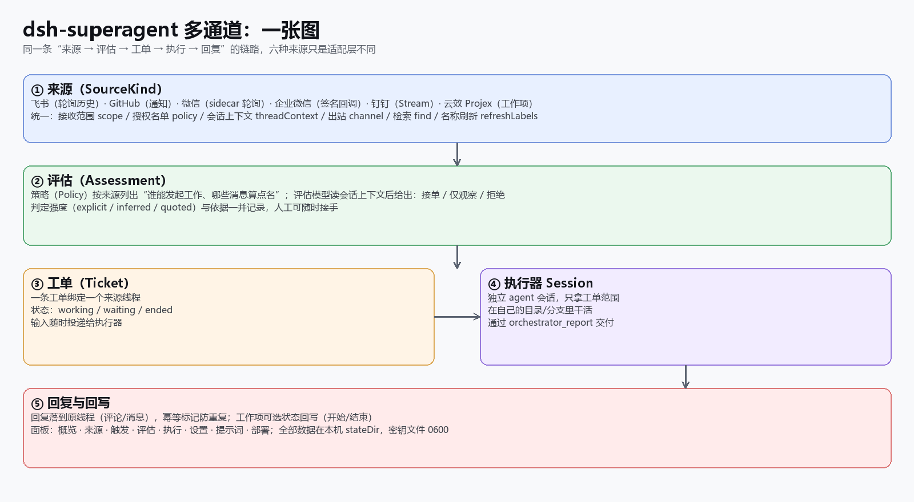
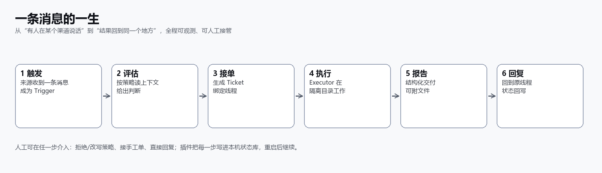

# Documentation Overview

> Language: [English](README.en-US.md) · [中文](README.md)

This directory describes what `dsh-superagent multi-channel` (2.4.0, reviewed 2026-11-14) **actually provides** today. **Every document exists in both Chinese and English**: Chinese files carry `.zh-CN.md`, English files `.en-US.md`, and the base name stays with the original; every page has a language switch at the top. Every page reflects the current implementation; platform-limit topics are itemized in [capability-matrix.md](extensions/capability-matrix.md) as "not possible" rather than omitted.

## Reading order

| # | English | 中文 |
| --- | --- | --- |
| 1 | [000-philosophy.md](000-philosophy.md) | [000-philosophy.zh-CN.md](000-philosophy.zh-CN.md) |
| 2 | [001-domain.md](001-domain.md) | [001-domain.zh-CN.md](001-domain.zh-CN.md) |
| 3 | [002-authorization.md](002-authorization.md) | [002-authorization.zh-CN.md](002-authorization.zh-CN.md) |
| 4 | [003-execution.md](003-execution.md) | [003-execution.zh-CN.md](003-execution.zh-CN.md) |
| 5 | [004-prompts.md](004-prompts.md) | [004-prompts.zh-CN.md](004-prompts.zh-CN.md) |
| 6 | [005-panel.en-US.md](005-panel.en-US.md) | [005-panel.md](005-panel.md) |
| 7 | [006-deployment.md](006-deployment.md) | [006-deployment.zh-CN.md](006-deployment.zh-CN.md) |
| 8 | [007-architecture.md](007-architecture.md) | [007-architecture.zh-CN.md](007-architecture.zh-CN.md) |
| 9 | [008-cookbook.en-US.md](008-cookbook.en-US.md) | [008-cookbook.md](008-cookbook.md) |
| — | [../EXTENSIONS.md](../EXTENSIONS.md) | [../EXTENSIONS.zh-CN.md](../EXTENSIONS.zh-CN.md) |
| — | [extensions/capability-matrix.md](extensions/capability-matrix.md) | [extensions/capability-matrix.zh-CN.md](extensions/capability-matrix.zh-CN.md) |
| — | [extensions/](extensions/) (each ADR has `.en-US.md` and `.zh-CN.md`) | same files, Chinese variants |
| — | [gallery.en.html](gallery.en.html) | [gallery.html](gallery.html) |
| — | [distribution/README.en-US.md](distribution/README.en-US.md) | [distribution/README.md](distribution/README.md) |
| — | [research/wechat-transport-research.en-US.md](research/wechat-transport-research.en-US.md) | [research/wechat-transport-research.zh-CN.md](research/wechat-transport-research.zh-CN.md) |

## At a glance

- **Unified input**: all six Sources normalize into the same `Trigger` (Thread, initiator, structured @, raw ID, optional image).
- **Unified decision**: Policy configures lists and admission tables per Source; the Assessment reads context and then returns accept / observe only / reject, recording strength and grounds.
- **Unified execution**: one Ticket, one Executor Session, an independent directory/branch, structured delivery.
- **Unified feedback**: replies land back in the original Thread, comments carry an idempotency marker; work items can have their status written back.

## Screenshot conventions

- `images/panel-*.png` are **real screenshots**; sensitive information (project/organization ID, token paths, names, group names, Session titles) is redacted; a few images carry red callout boxes.
- `images/architecture.png`, `lifecycle.png`, `sources.png`, `install.png` are **diagrams** drawn to the current implementation.
- Put new screenshots in `docs/images/`, named `panel-<page>.png`, and state "real / diagram" in the body caption.

## Documentation maintenance conventions

- When changing the capability surface (new Source, field, action), update in step: this page, the page descriptions in [005](005-panel.md), the module/test tables in [007](007-architecture.md), [capability-matrix](extensions/capability-matrix.md), and [CHANGELOG](../CHANGELOG.md).
- Test counts and commands live only in [README](../README.zh-CN.md) and [007](007-architecture.md), to avoid drift in multiple places.
