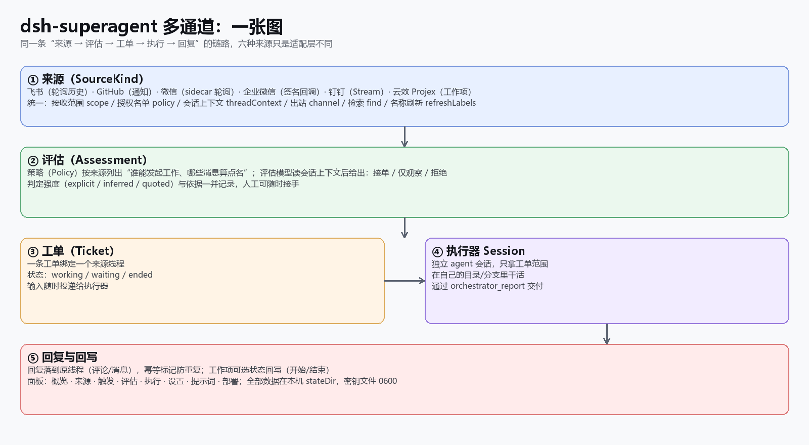
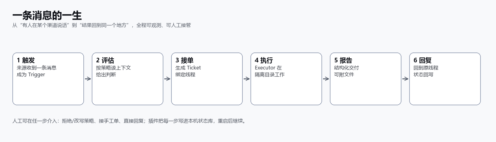

# 文档总览

> 语言：[中文](README.md) · [English](README.en-US.md)

本目录描述 `dsh-superagent 多通道`（2.4.0，2026-11-14 复核）现在**实际具备**的能力。**每一篇文档都有中英两份**：中文文件名带 `.zh-CN.md`，英文带 `.en-US.md`，基准文件保留原名；每篇顶部都有语言切换。所有页面都以当前实现为准；与平台限制相关的内容在
[capability-matrix.md](extensions/capability-matrix.md) 里逐项标注为「做不到」而不是省略。

## 阅读顺序

| 顺序 | 中文 | English |
| --- | --- | --- |
| 1 | [000-philosophy.zh-CN.md](000-philosophy.zh-CN.md) | [000-philosophy.md](000-philosophy.md) |
| 2 | [001-domain.zh-CN.md](001-domain.zh-CN.md) | [001-domain.md](001-domain.md) |
| 3 | [002-authorization.zh-CN.md](002-authorization.zh-CN.md) | [002-authorization.md](002-authorization.md) |
| 4 | [003-execution.zh-CN.md](003-execution.zh-CN.md) | [003-execution.md](003-execution.md) |
| 5 | [004-prompts.zh-CN.md](004-prompts.zh-CN.md) | [004-prompts.md](004-prompts.md) |
| 6 | [005-panel.md](005-panel.md) | [005-panel.en-US.md](005-panel.en-US.md) |
| 7 | [006-deployment.zh-CN.md](006-deployment.zh-CN.md) | [006-deployment.md](006-deployment.md) |
| 8 | [007-architecture.zh-CN.md](007-architecture.zh-CN.md) | [007-architecture.md](007-architecture.md) |
| 9 | [008-cookbook.md](008-cookbook.md) | [008-cookbook.en-US.md](008-cookbook.en-US.md) |
| — | [../EXTENSIONS.zh-CN.md](../EXTENSIONS.zh-CN.md) | [../EXTENSIONS.md](../EXTENSIONS.md) |
| — | [extensions/capability-matrix.zh-CN.md](extensions/capability-matrix.zh-CN.md) | [extensions/capability-matrix.md](extensions/capability-matrix.md) |
| — | [extensions/](extensions/)（每个 ADR 有 `.zh-CN.md` / `.en-US.md` 两份） | same files, English variants |
| — | [gallery.html](gallery.html) | [gallery.en.html](gallery.en.html) |
| — | [distribution/README.md](distribution/README.md) | [distribution/README.en-US.md](distribution/README.en-US.md) |
| — | [research/wechat-transport-research.zh-CN.md](research/wechat-transport-research.zh-CN.md) | [research/wechat-transport-research.en-US.md](research/wechat-transport-research.en-US.md) |

## 一页看懂

- **输入统一**：六个来源都归一成同一个 `Trigger`（线程、发起人、结构化 @、原始 ID、可选图片）。
- **判断统一**：策略按来源配置名单与准入表；评估读上下文后给出 接单 / 仅观察 / 拒绝，并记录强度与依据。
- **执行统一**：一条工单一个执行器 Session，独立目录/分支，结构化交付。
- **回流统一**：回复落回原线程，评论带幂等标记；工作项可回写状态。

## 截图约定

- `images/panel-*.png` 是**实机截图**，敏感信息（项目/组织 ID、令牌路径、姓名、群名、会话标题）已打码；个别图带讲解红框。
- `images/architecture.png`、`lifecycle.png`、`sources.png`、`install.png` 是按当前实现绘制的**示意图**。
- 新增截图时放在 `docs/images/`，命名 `panel-<页面>.png`，并在正文图注写明「实机 / 示意」。

## 文档维护约定

- 改动能力面（新增来源、字段、动作）时，同步更新：本页、[005](005-panel.md) 的页面说明、[007](007-architecture.md) 的模块/测试表、
  [capability-matrix](extensions/capability-matrix.md)，以及 [CHANGELOG](../CHANGELOG.md)。
- 测试数量与命令只写在 [README](../README.zh-CN.md) 与 [007](007-architecture.md)，避免多处漂移。
